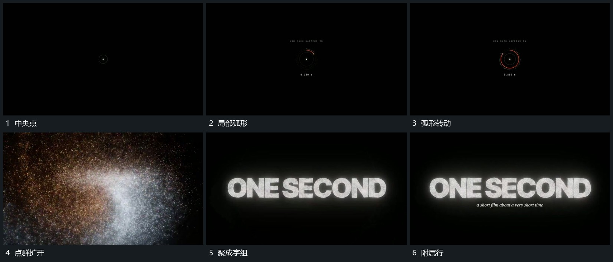

# 中央点建立局部弧形，点群扩开再聚成字组

## 运动指令

从中央点建立局部弧形，弧形沿自身方向转动。随后点群向外扩开，再聚回字组轮廓，字组完整后附属短行接入，整体稳定。

## 视频切片

[播放本机制的原片切片](m01.mp4)

覆盖分镜中“中央点”至“附属行”的连续过程，并保留邻近的前后衔接画面；原片中交叠发生的动作一并保留。

## 分镜过程

## 组合与调整

不推定点群算法，采用可见扩开与聚合。字组必须在收束后保持清楚。
