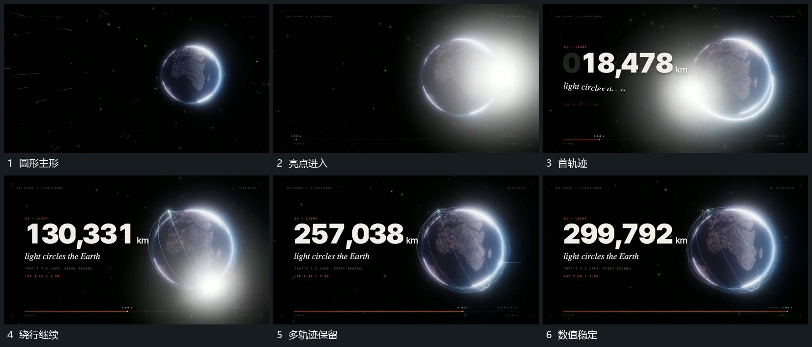

# 亮点沿圆形表面绕行并留轨迹，旁侧数值增长

## 运动指令

保持圆形主形，让亮点沿其表面绕行，经过路径留下可见轨迹。亮点继续绕行时旧轨迹保留，旁侧数值持续增加，下方长条沿推进延长，到结果后数值稳定。

## 视频切片

[播放本机制的原片切片](m02.mp4)

覆盖分镜中“圆形主形”至“数值稳定”的连续过程，并保留邻近的前后衔接画面；原片中交叠发生的动作一并保留。

## 分镜过程

## 组合与调整

不继承原片天体主题，圆形可替换为任意可绕行主形。
