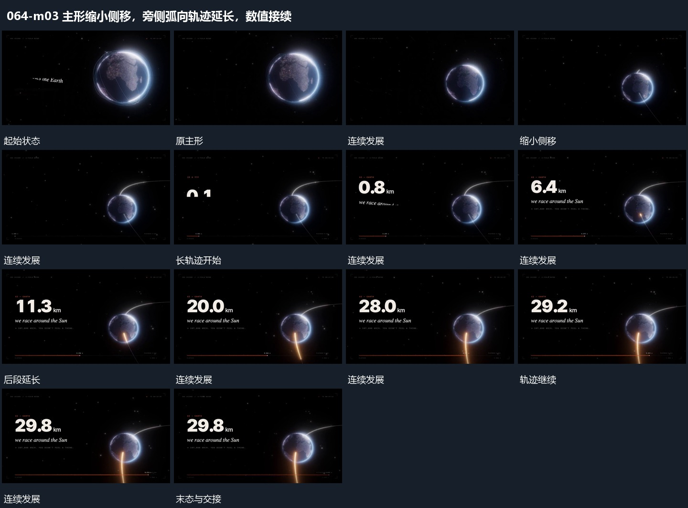

# 主形缩小侧移，旁侧弧向轨迹延长，数值接续

## 运动指令

将主形缩小并移向一侧，让旁侧长轨迹沿弧向延长。主形继续小幅转动，已建立轨迹保持，前景数值在新位置接续增长，到目标后稳定。

## 视频切片

[播放本机制的原片切片](m03.mp4)

保留起始准备、连续发展和完成或明确交接；首尾按本段运动范围裁切，不拼接、不变速。尾部只保留理解结果所需的展示。

## 分镜过程

## 组合与调整

缩移过程为长路径让空间，别缩小后立刻切走原主形。
