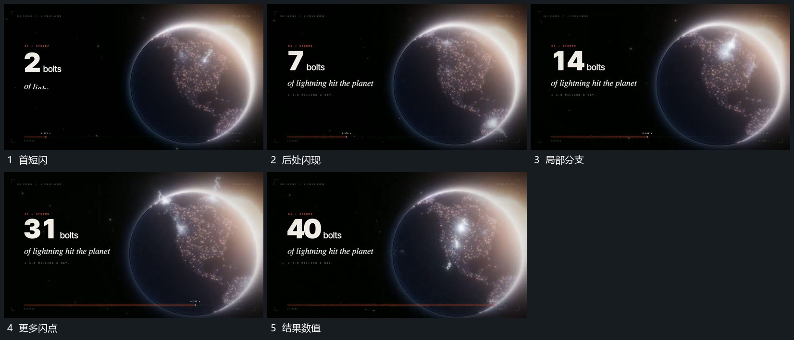

# 主形表面短闪分批出现，局部分支线随后追加

## 运动指令

保留主形，在其表面不同局部错峰出现短闪，短闪周边补入少量分支线，随后退去。主形位置保持，旁侧数值随每批变化继续增加，完整后收住结果。

## 视频切片

[播放本机制的原片切片](m04.mp4)

覆盖分镜中“首短闪”至“结果数值”的连续过程，并保留邻近的前后衔接画面；原片中交叠发生的动作一并保留。

## 分镜过程

## 组合与调整

不推定现实事件或精确次数，采用可见的分批局部活动。
