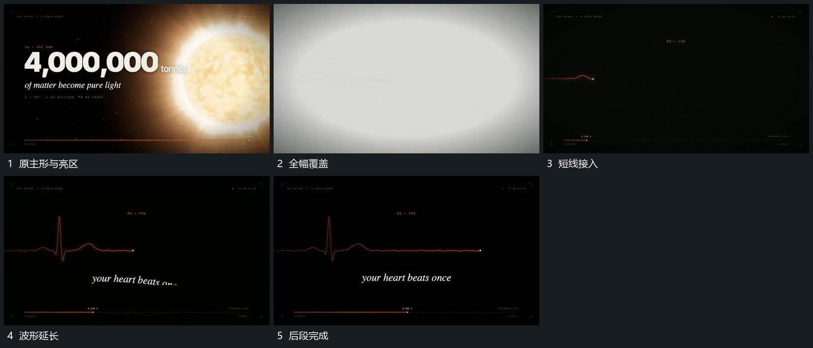

# 亮区放大覆盖全幅，短线接管并延长为波形

## 运动指令

将亮区向外放大到覆盖全画面，在覆盖中退出原主形。覆盖退去后由短线接管，从左向右延长成波形，局部起伏先出现，后段回到较细线，短字随后接入。

## 视频切片

[播放本机制的原片切片](m05.mp4)

覆盖分镜中“原主形与亮区”至“后段完成”的连续过程，并保留邻近的前后衔接画面；原片中交叠发生的动作一并保留。

## 分镜过程

## 组合与调整

全幅覆盖和线形增长要各自清楚，不直接从主形切到完整波形静图。
