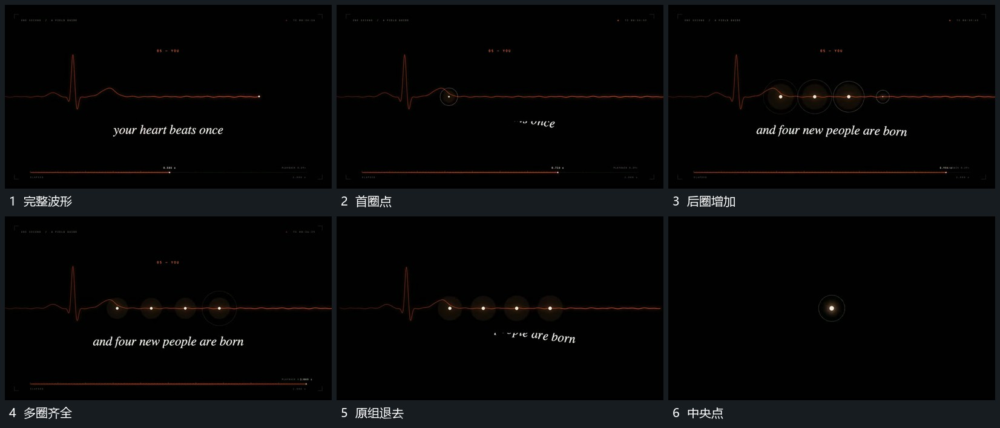

# 波形局部小圈与点逐项建立，整组退去只留中央点

## 运动指令

在完整波形的几个局部逐项建立小圈与点，前项保持，后项继续加入。短字在下方接续，末尾波形与外圈一起退去，只保留中央点接给结尾。

## 视频切片

[播放本机制的原片切片](m06.mp4)

覆盖分镜中“完整波形”至“中央点”的连续过程，并保留邻近的前后衔接画面；原片中交叠发生的动作一并保留。

## 分镜过程

## 组合与调整

点的数量可换，中央保留点应成为下一机制的真实起点。
