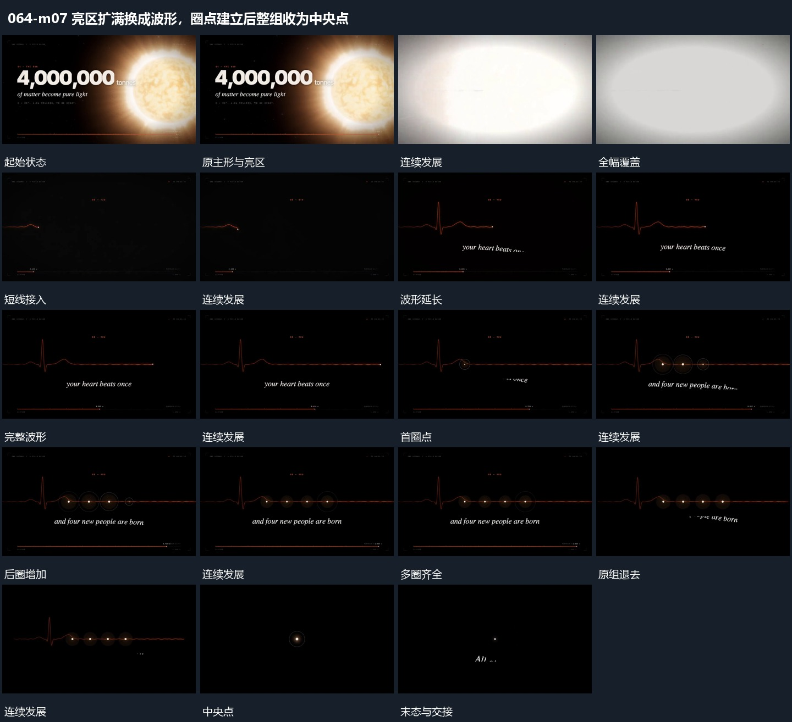

# 亮区扩满换成波形，圈点建立后整组收为中央点

## 运动指令

亮区放大遮住画面，新短线接管并延长成波形；局部圈点逐项补入，整组退去后留下中央点结束。

1. **亮区放大覆盖全幅，短线接管并延长为波形**

将亮区向外放大到覆盖全画面，在覆盖中退出原主形。覆盖退去后由短线接管，从左向右延长成波形，局部起伏先出现，后段回到较细线，短字随后接入。

2. **波形局部小圈与点逐项建立，整组退去只留中央点**

在完整波形的几个局部逐项建立小圈与点，前项保持，后项继续加入。短字在下方接续，末尾波形与外圈一起退去，只保留中央点接给结尾。

整段结束：小圈齐全后退去，中央点保留 保留必要落稳与交接，中间已建立的参照沿用到下一步骤。

## 视频切片

[播放本机制的原片切片](m07.mp4)

保留起始准备、连续发展和完成或明确交接；首尾按本段运动范围裁切，不拼接、不变速。相连的小动作合为同一完整段落。

## 分镜过程

## 组合与调整

亮区放大遮住画面，新短线接管并延长成波形；局部圈点逐项补入，整组退去后留下中央点结束。 复用时可调整元素数量、幅度和相对节奏，保留上述进入、交叠与完成关系；不直接沿用原片题材或时长。

全幅覆盖和线形增长要各自清楚，不直接从主形切到完整波形静图。

点的数量可换，中央保留点应成为下一机制的真实起点。
