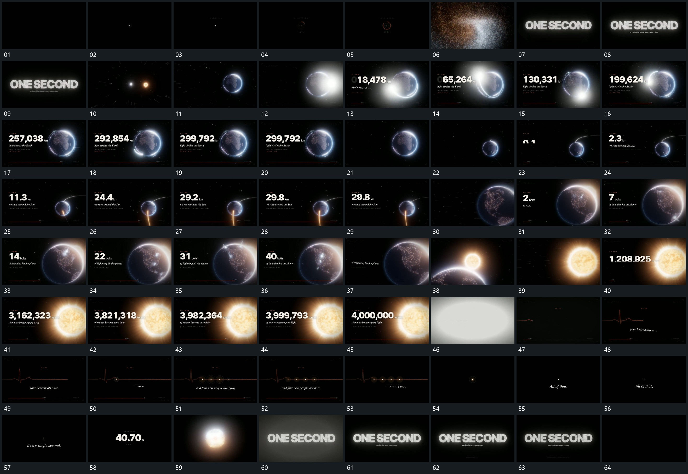

# 064｜原片运动总览

[观看完整原片](video.mp4)

## 运动总览

开头 中央点建立局部弧形，点群扩开再聚成字组 从中央点建立局部弧形，弧形转动后点群扩开，重新聚成字组。亮点沿圆形表面绕行并留轨迹，旁侧数值增长 保留侧方圆形主形，让亮点沿其表面绕行并留下轨迹，旁侧数值增长，下长条延长。

中段 主形缩小侧移，旁侧弧向轨迹延长，数值接续 将主形缩小侧移，沿其旁侧延伸弧向长轨迹，已有轨迹保留；旁值继续变化。主形表面短闪分批出现，局部分支线随后追加 在主形表面逐项出现短闪与小分支，外部数值随次数累积。下一主形接管后数值继续增长，最后 亮区放大覆盖全幅，短线接管并延长为波形 放大亮区覆盖全画面，再由短线接管，波形向右延长。

后段 波形局部小圈与点逐项建立，整组退去只留中央点 在波形局部逐项建立小圈和点，短字接续，整组退去后只留中央点。结尾重用 中央点建立局部弧形，点群扩开再聚成字组 的点群到字组聚合，再补附属行保持。

## 完整运动段落

以下按原片中的出现顺序引用。建立、内部发展及完成反馈放在同一段中；同时发生的局部动作与运镜写在同一份指令里。不同段之间可以是连续接管，也可以是直接切换，不能仅凭条目相邻认定可直接拼接。重复出现的同类运动采用一次连续代表范围，切片不以逐段无缝覆盖整片为目标。

1. [中央点建立局部弧形，点群扩开再聚成字组](mechanisms/m01.md)：先弧形活动，再扩散聚合

2. [亮点沿圆形表面绕行并留轨迹，旁侧数值增长](mechanisms/m02.md)：轨迹持续，外数同步推进

3. [主形缩小侧移，旁侧弧向轨迹延长，数值接续](mechanisms/m03.md)：先缩移，后延长外路径

4. [主形表面短闪分批出现，局部分支线随后追加](mechanisms/m04.md)：短闪错峰，主形保持

5. [亮区扩满换成波形，圈点建立后整组收为中央点](mechanisms/m07.md)：亮区放大遮住画面，新短线接管并延长成波形；局部圈点逐项补入，整组退去后留下中央点结束。

切片保留起始准备、必要内部停顿和完成或明确交接；首尾省略无新发展的等待，持续运动不要求人为停住。以上基于真实源帧序列和重点边界核对，不等同于全片连续声画审片。

## 完整64宫格

