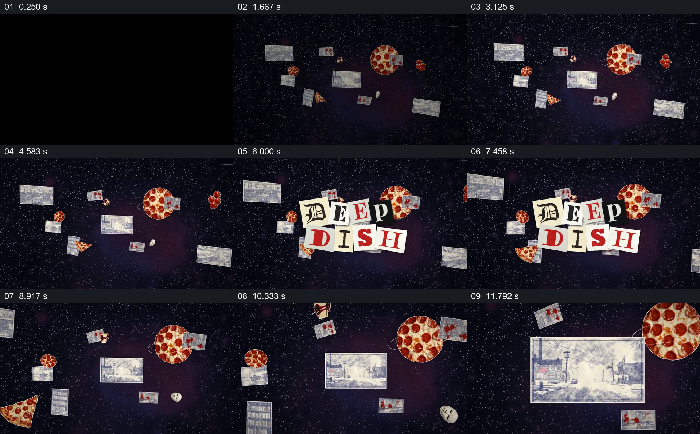

# 让漂浮物集合组成标题，再选中一张街景进入故事

- 作品：案例 013《拼贴影像、旧纸与字体》（库内索引名）。
- 原片范围：00:00.000–00:13.000，含起点、不含终点；[完整原片](../video.mp4)｜[本卡片段](c01.mp4)，片段起点对应原片 0.000 秒。
- 范围依据：集合与标题完成后，街景取得中心；下一段进入店面。
- 观察方式：核看全片 64 帧总览和本卡九宫格；未独立连续原速观看和听审，快切、动作和声音关系待核，迁移尚未实测。人物、票据与监控界面均仅按虚构作品画面描述，不视为真实事件。

## 原画面具体怎样设计

深色星点背景中散放披萨、街景图、小纸片及面具等对象；不同对象大小与位置各异，街景暂时只是其中一张。剪报字体拼成“DEEP DISH”，在中央覆盖部分散点；标题退出后，街景图由小到大，周围披萨和纸片仍短暂保留，最后街景成为主要画面。

## 为什么这样设计，好在哪里

散点先让观众认识作品的材料世界，标题将分散对象暂时归为同一身份；街景从其中取得中心，形成从全局到具体地点的观看路径。若开场直接全屏街景，会缺少后续拼贴材料的整体预告。

## 可直接使用的创意指令

准备能代表故事世界的多个对象及一个真正用于后续展开的场所；先让对象在共同空间中保持各自可辨认，再以标题暂时聚合视觉中心。标题退开后，将被选中的场所扩大，并在它接管前保留少量原集合参照。媒介、背景及对象可替换；需保留集合、选择与进入之间的关系。
