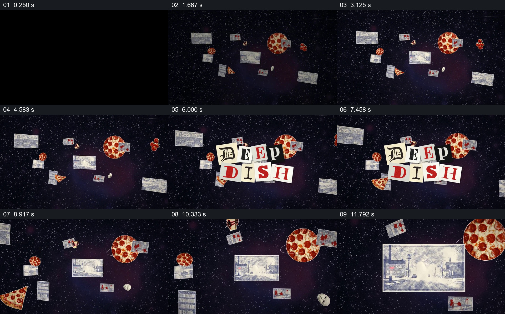

# 漂浮的披萨与剪报汇成标题，再选中街景

- 作品：案例 013《拼贴影像、旧纸与字体》（索引名称）。
- 原片范围：00:00.000–00:13.000，含起点、不含终点；[完整原片](../video.mp4)｜[本卡片段](c01.mp4)。
- 观察方式：依据整片 64 宫格和约每秒一次的真实源帧观察，未连续原速观看或听审；声音、语气与完整播放节奏未确认。

## 原画面具体怎样设计

黑色星点背景上分布着披萨、碎纸、照片与街景图。不同字体的纸片拼成“DEEP DISH”标题，停留后标题退去；同一组漂浮物中，一张浅色街景逐渐占据中央并放大，接入下一处街道空间。

## 为什么这样设计，好在哪里

标题和周围物件来自同一组视觉材料，使名称、题材物件与下一处空间在一个画面里建立关联。不是突然进入街道，而是先在集合中看见目的地，再扩大它，观众能追踪入口。

以上为依据画面的分析，非作者自述；预期观看效果未经观众测试。

## 可直接使用的创意指令

当开场要从多个材料进入一个具体地点时，选取少量与主题确有关系的物件和地点图，让它们在共同背景中同时出现；用可读的剪字或其他文字形式建立标题，随后保留其中一张地点图并放大到足以承接下一场。材料可来自虚构插画或真实授权影像，但二者的事实地位要在新作品中明确。
