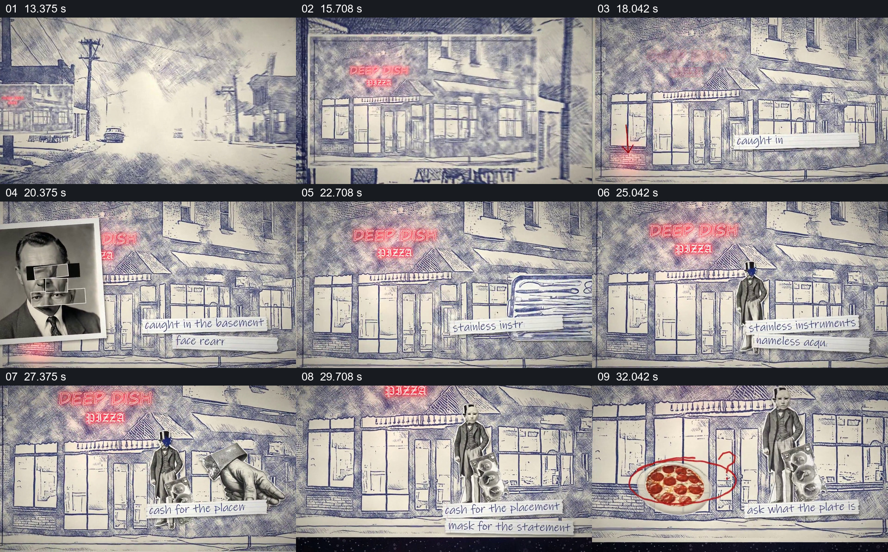

# 在固定街景上逐项贴入人物、文字与披萨

- 作品：案例 013《拼贴影像、旧纸与字体》（索引名称）。
- 原片范围：00:13.000–00:34.000，含起点、不含终点；[完整原片](../video.mp4)｜[本卡片段](c02.mp4)。
- 观察方式：依据整片 64 宫格和约每秒一次的真实源帧观察，未连续原速观看或听审；声音、语气与完整播放节奏未确认。

## 原画面具体怎样设计

蓝灰线描街道中，视野移向带红色招牌的店面。人物照片、器具、人物剪影和纸条文字先后叠在建筑前；随后披萨出现在店门附近并被红圈强调。街道切入线描餐厅，披萨仍在前景，位置与视觉主题延续。

## 为什么这样设计，好在哪里

建筑位置稳定，使不断增加的照片与文字被读成同一地点上的线索；红圈把注意从密集条目引到披萨。披萨从街外延续到室内，给跨空间切换一个可认的共同物件。这是虚构叙事安排，人物图像不是证据。

以上为依据画面的分析，非作者自述；预期观看效果未经观众测试。

## 可直接使用的创意指令

当一个地点需要承载多条线索时，先建立能辨认的环境与入口，在稳定空间中分批加入各自有明确职责的照片、文字或道具，给主要线索单独的焦点；若后续进入室内，让一个已建立且与新空间有关的物件继续出现。事实题材必须核对每条材料的来源和人物关系，不能用视觉并置暗示未经证实的关联。
