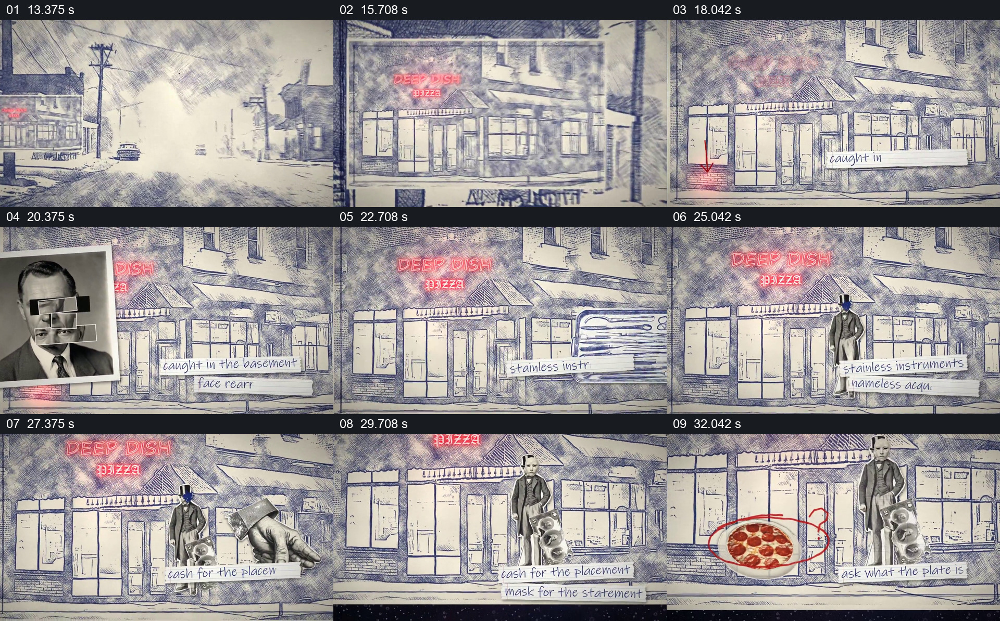

# 在店面上逐项叠加人物与物件，再用披萨连接室内

- 作品：案例 013《拼贴影像、旧纸与字体》（库内索引名）。
- 原片范围：00:13.000–00:34.000，含起点、不含终点；[完整原片](../video.mp4)｜[本卡片段](c02.mp4)，片段起点对应原片 13.000 秒。
- 范围依据：固定店面上人物和物件逐项发展，披萨接入室内。
- 观察方式：核看全片 64 帧总览和本卡九宫格；未独立连续原速观看和听审，快切、动作和声音关系待核，迁移尚未实测。人物、票据与监控界面均仅按虚构作品画面描述，不视为真实事件。

## 原画面具体怎样设计

蓝色素描街道全屏后，红色店名“DEEP DISH PIZZA”的店面被框出并扩大；店面保持背景。红色箭头、被遮挡五官的人像、器具托盘、戴帽人物和大手等拼贴对象先后出现在建筑前，手写纸条落在附近。披萨与红色圈注最后成为前景重点，随后画面进入餐厅内部。

## 为什么这样设计，好在哪里

建筑持续存在，使更换的前景对象都能被归到同一个地点；红色店名、箭头与圈注从灰蓝线稿中获得注意。披萨从前景物件接到室内餐桌，承担场景间的共同参照。人物和道具均是虚构拼贴，不能推断真实人物关系。

## 可直接使用的创意指令

选择能够稳定识别的地点图像，让地点先独立建立；再依叙事顺序将与该地点有关的角色、物品及短文字放到不同层，允许旧物退出但保留地点作为参照。最后选一个已出现的物件带入下一空间。地点、剪纸风格与标记颜色可改；关键是新增对象有共同场所和明确交接。
