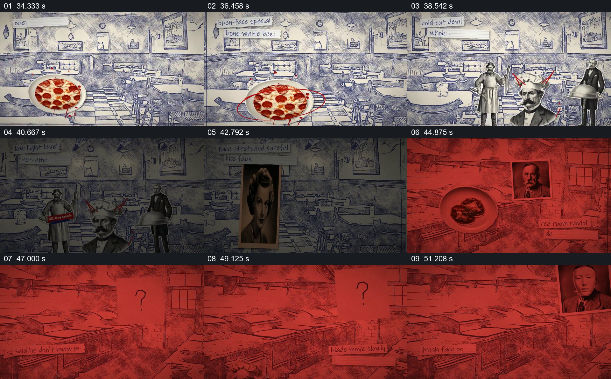

# 从餐桌与食物转入暗红厨房，让人物和疑问改变空间气氛

- 作品：案例 013《拼贴影像、旧纸与字体》（库内索引名）。
- 原片范围：00:34.000–00:53.000，含起点、不含终点；[完整原片](../video.mp4)｜[本卡片段](c03.mp4)，片段起点对应原片 34.000 秒。
- 范围依据：餐厅、人物、红色厨房和问号共同完成气氛变化；随后换监控外观。
- 观察方式：核看全片 64 帧总览和本卡九宫格；未独立连续原速观看和听审，快切、动作和声音关系待核，迁移尚未实测。人物、票据与监控界面均仅按虚构作品画面描述，不视为真实事件。

## 原画面具体怎样设计

餐厅桌椅线稿在全画面保持，披萨和盘子位于前景；随后厨师、侍者及带红色手绘角的肖像分别加入。背景变暗后，中间出现女性肖像，再切到红色覆盖的厨房，食物、人物照片和手写文字先后放到灶台前；一个大问号成为后段醒目标记，之后更多照片和文字出现。

## 为什么这样设计，好在哪里

同一餐饮语境从桌面进入厨房，但明暗、颜色和图像对象改变了观看重点；红色并不是单纯的装饰，它让后段整幅空间的状态与前段不同。问号把未说明的关系留作疑问，而非给出真实结论。

## 可直接使用的创意指令

当故事需要将一个熟悉场所转向另一种虚构处境，先用稳定环境与具体物件建立正常空间，再引入能够改变理解的角色或信息。让色彩、明暗和前景对象一起转变，最后保留一个观众可识别的问题或结果。场所、人物与色彩可以重设；疑问和推测需与事实材料区分。
