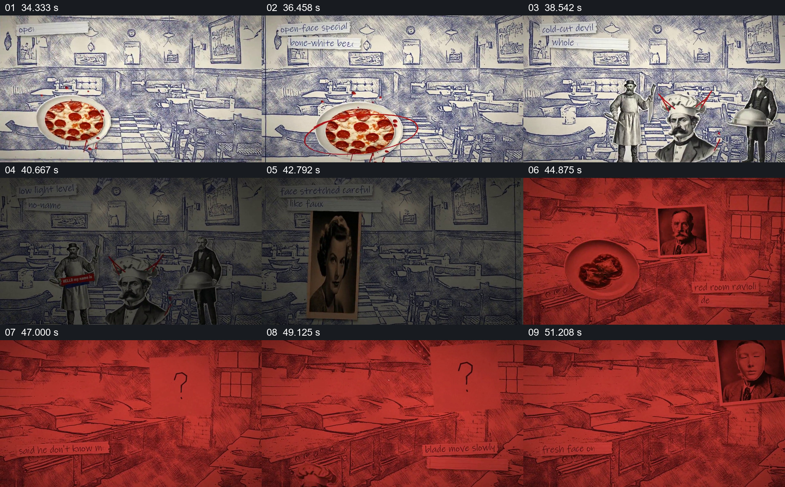

# 餐厅内从寻常陈设转为红色疑问

- 作品：案例 013《拼贴影像、旧纸与字体》（索引名称）。
- 原片范围：00:34.000–00:53.000，含起点、不含终点；[完整原片](../video.mp4)｜[本卡片段](c03.mp4)。
- 观察方式：依据整片 64 宫格和约每秒一次的真实源帧观察，未连续原速观看或听审；声音、语气与完整播放节奏未确认。

## 原画面具体怎样设计

线描餐厅内摆有披萨，人物剪影与黑白肖像陆续进入；上方纸条文字变化。随后画面整体转红，餐厅透过红色仍可见，盘子、人物肖像和大问号等图形依次出现，临近结束又出现多张头像。

## 为什么这样设计，好在哪里

不换掉原有餐厅，而是保留可辨的桌椅并改变颜色、覆盖内容，使情绪变化发生在同一地点。问号与肖像把观众注意转到不确定的关系上；画面并未提供真实案件证据，人物关联属于虚构表现。

以上为依据画面的分析，非作者自述；预期观看效果未经观众测试。

## 可直接使用的创意指令

当虚构叙事需要让普通场所逐渐变得不安时，先用空间陈设和一个核心物件建立可辨的常态，再保留环境轮廓，逐步改变覆盖色、加入与剧情相关的图像或疑问符号，保留前后可比较的空间。涉及真实人物或事实时不得将未经证实的联想设计成指控，须使用核实来源和明确标识。
