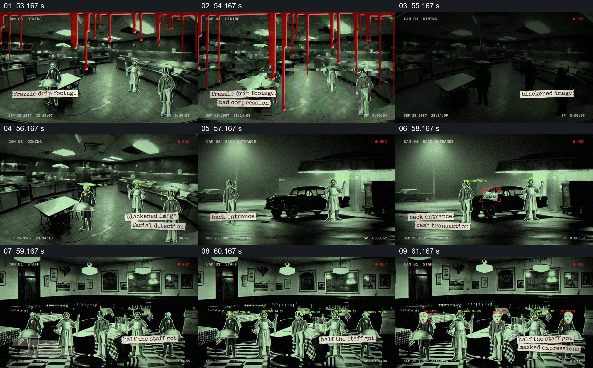

# 用多机位监控外观切换室内与后门

- 作品：案例 013《拼贴影像、旧纸与字体》（索引名称）。
- 原片范围：00:53.000–01:02.000，含起点、不含终点；[完整原片](../video.mp4)｜[本卡片段](c04.mp4)。
- 观察方式：依据整片 64 宫格和约每秒一次的真实源帧观察，未连续原速观看或听审；声音、语气与完整播放节奏未确认。

## 原画面具体怎样设计

画面换为绿色低照度的餐厅影像，顶部有“CAM”和录制标记，红色滴落形状叠在上方；随后切到汽车与人物所在的后门，再切员工区。人物周围有描边或识别样式标记，底部剪纸文字逐项出现。

## 为什么这样设计，好在哪里

统一摄像机标记和色调把不同地点组织为同一观察方式，地点切换扩大了观察范围；描边和短纸条引导注意具体位置。画面是作品中的监控风格设计，不能由这些视觉标记推断它是真实监控或真实识别结果。

以上为依据画面的分析，非作者自述；预期观看效果未经观众测试。

## 可直接使用的创意指令

当虚构故事需要呈现多个位置的受限观察时，先给每个位置明确画面范围与一致的摄像机标记，再逐个切换场所，用少量描边或短注释指出观众需要关注的主体。保留能区分地点的环境，不以装饰性时间码或识别框冒充真实监控；事实作品应使用可追溯原始影像并说明来源。
