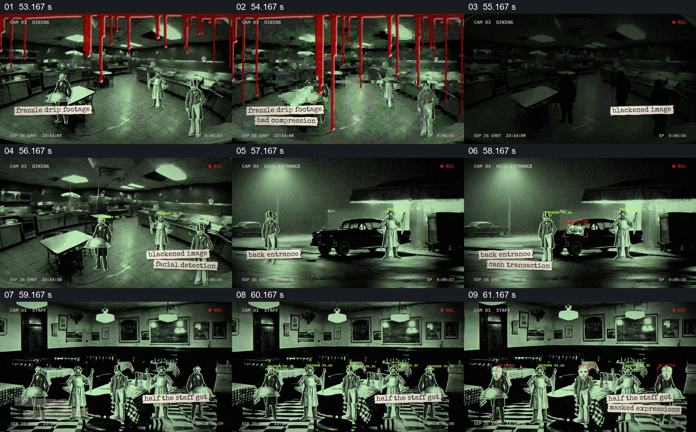

# 以监控外观依次查看三个位置，再用检测框强调异常

- 作品：案例 013《拼贴影像、旧纸与字体》（库内索引名）。
- 原片范围：00:53.000–01:02.000，含起点、不含终点；[完整原片](../video.mp4)｜[本卡片段](c04.mp4)，片段起点对应原片 53.000 秒。
- 范围依据：三个位置由统一监控界面串联；之后回到餐厅插画。
- 观察方式：核看全片 64 帧总览和本卡九宫格；未独立连续原速观看和听审，快切、动作和声音关系待核，迁移尚未实测。人物、票据与监控界面均仅按虚构作品画面描述，不视为真实事件。

## 原画面具体怎样设计

绿色低照度的餐厅画面带 CAM 标签、REC、时间与红色滴落覆盖；画面出现压缩块与变暗状态，人物轮廓旁随后出现检测框。接着视角换到后门，汽车和人物并列，红框标记中间物件；再换到员工区，多个人物站在餐桌前，部分脸部出现识别框与“NO MATCH”标记。各镜头保留同一监控式界面。

## 为什么这样设计，好在哪里

统一的时间、机位与检测界面让地点变化被理解为同一组观察，检测框则在复杂暗画面中引导注意到人物与指定对象。若只叠加监控噪点而没有不同位置或可辨认对象，就只剩风格。此段为片中伪监控演出，不是实际监控或证据。

## 可直接使用的创意指令

在明确虚构前提下，先确定各观察位置与需要观众看见的对象，使用统一的画面边框和机位信息连接它们；每个位置保留足够环境，再将少量标记放在真正相关的主体附近。保持界面一致但允许空间更换。真实证据场景必须使用真实来源，不能把模拟识别框、日期或监控外观冒充记录。
