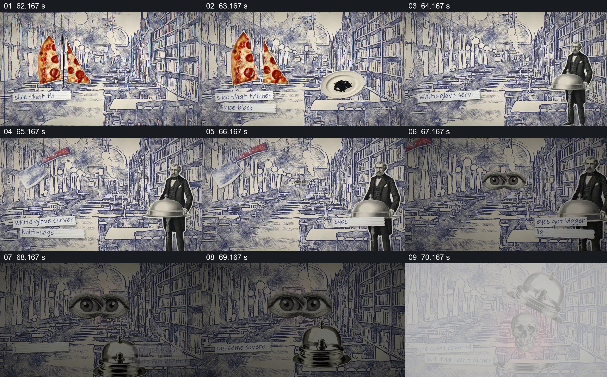

# 让眼睛和罩盘共同等待，再揭露被遮住的对象

- 作品：案例 013《拼贴影像、旧纸与字体》（库内索引名）。
- 原片范围：01:02.000–01:11.000，含起点、不含终点；[完整原片](../video.mp4)｜[本卡片段](c05.mp4)，片段起点对应原片 62.000 秒。
- 范围依据：罩盘、眼睛与揭示构成一个依赖关系；随后换到书架。
- 观察方式：核看全片 64 帧总览和本卡九宫格；未独立连续原速观看和听审，快切、动作和声音关系待核，迁移尚未实测。人物、票据与监控界面均仅按虚构作品画面描述，不视为真实事件。

## 原画面具体怎样设计

蓝色线稿餐厅内先有披萨和盘子，右侧人物端着带金属罩的托盘；切片中左侧出现刀具，人物与罩盘继续保留。背景逐渐变暗，空中一双眼睛逐步变大，罩盘处于下方前景；到约 01:10，罩盖与盘子分开，骷髅显露。

## 为什么这样设计，好在哪里

罩盘本来暗示里面有一道菜，眼睛与变暗背景让注意力等待被遮住的内容，最后显露的骷髅改变对前面餐厅场面的理解。若从一开始就直接展示骷髅，结果仍在，但遮挡和等待形成的前后差异会消失。

## 可直接使用的创意指令

需要虚构揭示时，先让遮挡物与周围使用情境成立，再安排一个能指向该遮挡物的观察者或观看线索。保留环境和容器，直到揭开后的对象能被读清；揭示对象应与前文建立的期待形成有意义的变化。罩盘、眼睛与惊悚风格可换；保留期待、遮挡和结果的依赖关系。
