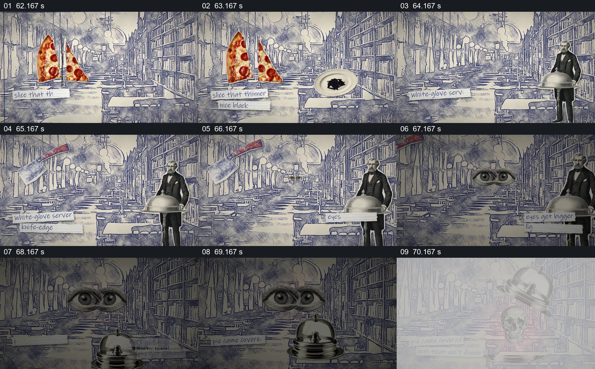

# 服务员端着罩盘，抬起后露出骷髅

- 作品：案例 013《拼贴影像、旧纸与字体》（索引名称）。
- 原片范围：01:02.000–01:11.000，含起点、不含终点；[完整原片](../video.mp4)｜[本卡片段](c05.mp4)。
- 观察方式：依据整片 64 宫格和约每秒一次的真实源帧观察，未连续原速观看或听审；声音、语气与完整播放节奏未确认。

## 原画面具体怎样设计

蓝灰线描餐厅再次出现，左侧有披萨和盘子，右侧服务员端着银色罩盘；画面中部增加一双眼睛，环境逐渐暗下来。罩盘位于前景，后续抽帧显示罩子抬起，底下出现骷髅造型。

## 为什么这样设计，好在哪里

服务员、餐盘和罩子都是容易识别的日常就餐关系，先让观众理解“要揭开什么”，再用反常内容改变期待。眼睛和暗化将注意维持在揭晓之前；具体动作快慢和音效未经听审。

以上为依据画面的分析，非作者自述；预期观看效果未经观众测试。

## 可直接使用的创意指令

当虚构场景需要通过一次揭晓改变观众预期时，先建立正常的物件关系与可辨遮挡，让观众清楚等待的是哪个容器；保留容器位置，加入少量与气氛有关的观察线索，再揭开遮挡并给结果留出可见时间。揭晓内容、情绪强度与形式按题材确定，不把虚构画面当成事实材料。
