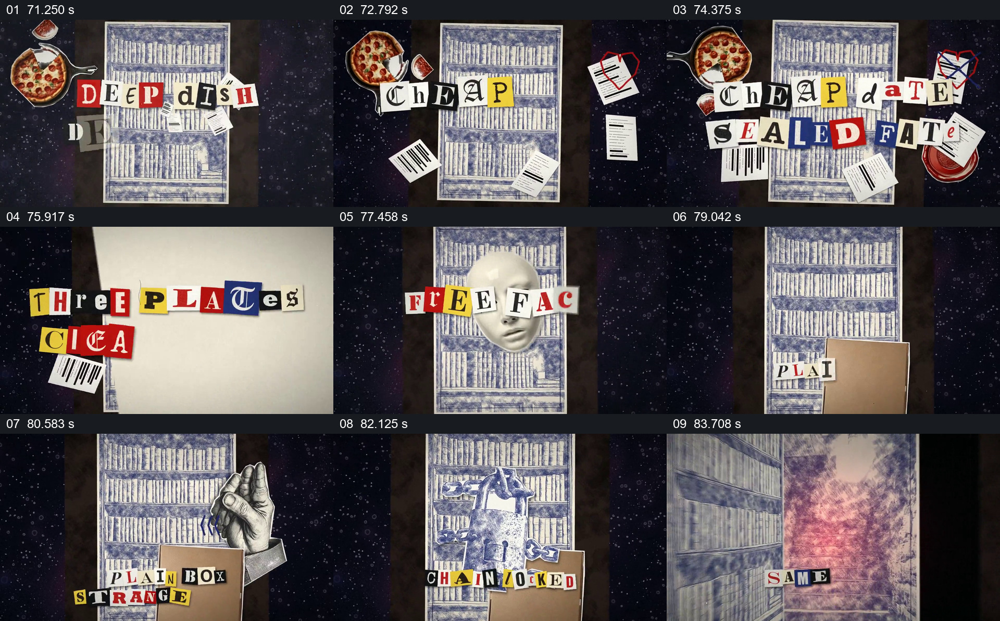

# 让剪报字穿过固定书架，再由锁与开口带入新空间

- 作品：案例 013《拼贴影像、旧纸与字体》（库内索引名）。
- 原片范围：01:11.000–01:25.000，含起点、不含终点；[完整原片](../video.mp4)｜[本卡片段](c06.mp4)，片段起点对应原片 71.000 秒。
- 范围依据：书架承载多项剪字并打开新空间；后续进入另一组人物和器具。
- 观察方式：核看全片 64 帧总览和本卡九宫格；未独立连续原速观看和听审，快切、动作和声音关系待核，迁移尚未实测。人物、票据与监控界面均仅按虚构作品画面描述，不视为真实事件。

## 原画面具体怎样设计

星点背景中一张书架正对观众，披萨、条码与纸张围绕它；不同字形的彩色剪报字组成多组短句，占据书架前方，再让位于面具、纸盒和手的插图。约 01:22，锁链与锁覆盖书架及盒子；随后书架像门一样转开，侧后露出粉色楼梯图像，新的空间由右侧进入。

## 为什么这样设计，好在哪里

书架是多组文字与对象变化时稳定的空间参照，锁和手把注意从漂浮字转向承载物本身；书架后方的新空间让原本的背景成为入口。如果新楼梯直接全屏替换，观众看不到两种空间通过书架建立的关系。

## 可直接使用的创意指令

选一个可贯穿多个信息片段的承载物，让文字和物件在其前方逐步出现并替换；当内容转向下一阶段时，将注意力从前景信息交给承载物上的开口、门或边缘，再露出另一个明确空间。可改变书架、字形、锁和空间类型；保留多项信息共享参照、参照成为入口的关系。
