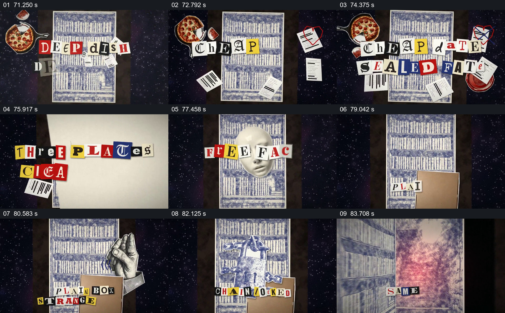

# 剪字绕着书架更替，书架打开通向另一空间

- 作品：案例 013《拼贴影像、旧纸与字体》（索引名称）。
- 原片范围：01:11.000–01:25.000，含起点、不含终点；[完整原片](../video.mp4)｜[本卡片段](c06.mp4)。
- 观察方式：依据整片 64 宫格和约每秒一次的真实源帧观察，未连续原速观看或听审；声音、语气与完整播放节奏未确认。

## 原画面具体怎样设计

深色背景中央是一幅书架图，披萨、票据等道具分散在两侧；不同颜色和字体的剪报字不断替换，部分文字与面具、盘子等图像同时出现。纸箱、手与锁链样式物件叠在书架前，书架随后像门一样打开，内部出现粉红色空间并逐渐占据画面。

## 为什么这样设计，好在哪里

书架在不断变化的文字与道具后方保持位置，给复杂剪贴提供稳定支点；锁和手把书架从背景转成可以打开的入口。观众先看到门后的新空间，再进入它，过渡有清楚的前后关系。

以上为依据画面的分析，非作者自述；预期观看效果未经观众测试。

## 可直接使用的创意指令

当需要用一段文字和道具引入下一地点时，选择一个具备明确开口的稳定主体，让少量与内容有关的短词和物件在其周围依次变化；在转场前加入与开口发生实际接触或遮挡关系的道具，再让主体打开，使下一空间先出现在开口内并逐渐扩大。文字数量和时长按可读性调整，装饰图像不能替代事实来源。
