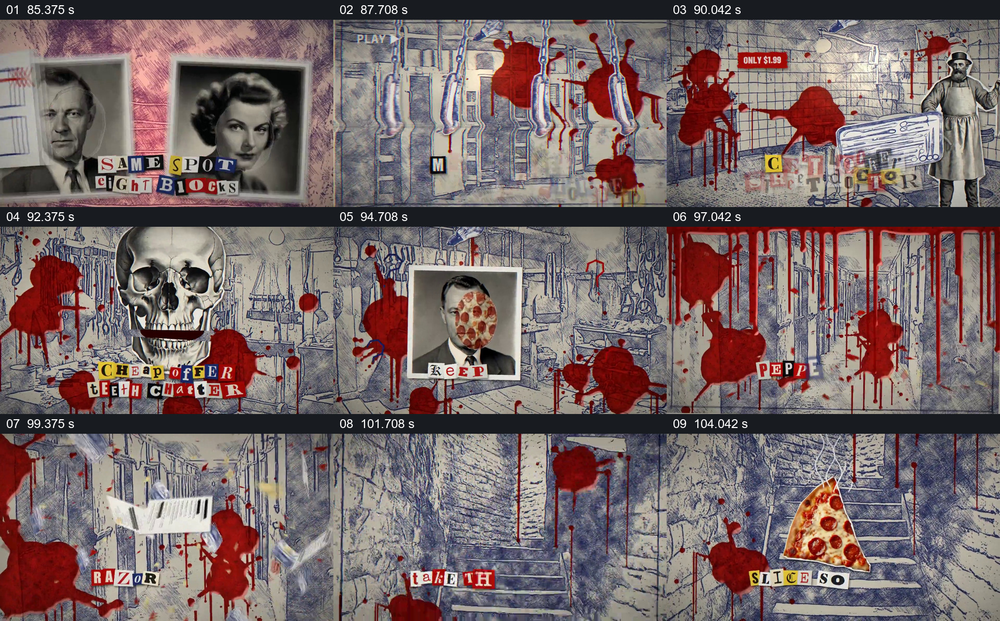

# 把人物照片与餐饮物件放进红色惊悚拼贴

- 作品：案例 013《拼贴影像、旧纸与字体》（索引名称）。
- 原片范围：01:25.000–01:46.000，含起点、不含终点；[完整原片](../video.mp4)｜[本卡片段](c07.mp4)。
- 观察方式：依据整片 64 宫格和约每秒一次的真实源帧观察，未连续原速观看或听审；声音、语气与完整播放节奏未确认。

## 原画面具体怎样设计

粉色纸面上两张人物照片与剪字相邻，之后切到线描空间，红色污迹覆盖墙面并向下滴落。人物、器具、骷髅、披萨与剪报字先后叠在同一环境中，后段出现楼梯及食物近景；红色痕迹作为跨画面的持续元素。

## 为什么这样设计，好在哪里

相同空间和红色痕迹为快速更换的图像提供连续背景；食物、人体图像与器具的并置形成作品内的不安联想。仅凭抽帧不能确认所有快速交换顺序，也不能把其中的人物和行为当成真实事件。

以上为依据画面的分析，非作者自述；预期观看效果未经观众测试。

## 可直接使用的创意指令

当制作明确虚构的惊悚拼贴时，先建立一个能持续辨认的空间和反复出现的视觉痕迹，再选取与故事有关的少量物件及文字，分批替换而非同时塞满画面；让关键画面有足够停留，再用共同元素接到下一场。人物肖像、血迹和行为仅按获得许可的虚构设定使用，现实事件须另有证据。
