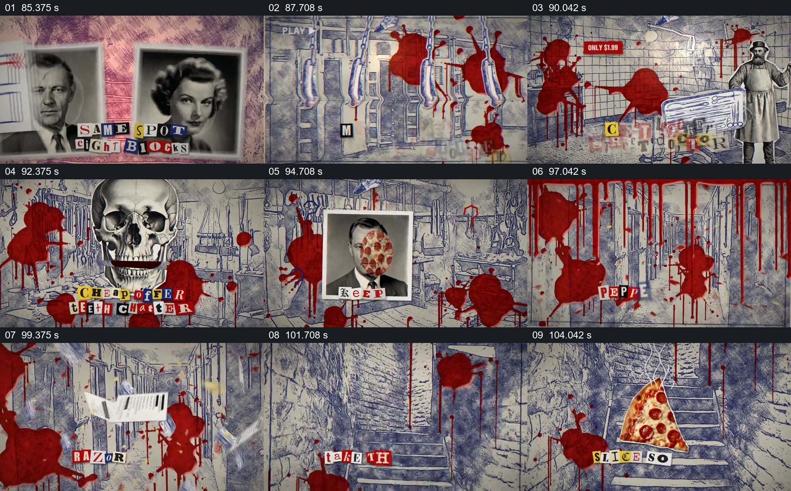

# 让人物照片接到红色线索空间，再以器具与食物持续接力

- 作品：案例 013《拼贴影像、旧纸与字体》（库内索引名）。
- 原片范围：01:25.000–01:46.000，含起点、不含终点；[完整原片](../video.mp4)｜[本卡片段](c07.mp4)，片段起点对应原片 85.000 秒。
- 范围依据：红色空间中多种图像接力，最后披萨与楼梯形成出口。
- 观察方式：核看全片 64 帧总览和本卡九宫格；未独立连续原速观看和听审，快切、动作和声音关系待核，迁移尚未实测。人物、票据与监控界面均仅按虚构作品画面描述，不视为真实事件。

## 原画面具体怎样设计

人物黑白照片和粉色纹理之后，画面转为蓝色线稿室内，红色滴落和斑迹覆盖墙面。不同源帧中依次可见服务人员、器具、骷髅、被披萨遮挡面部的肖像、纸张、女性照片和披萨切片；剪报字在下方组成短句。空间背景虽发生切换，红色斑迹与线稿材料持续出现，最后一片披萨位于楼梯前。

## 为什么这样设计，好在哪里

红色痕迹与线稿环境将多个本来不相同的对象组织在相近的视觉世界里；中心对象逐项接替，比同时把所有线索堆到一个画面更容易看清。食物与人物肖像互相遮挡构成视觉转化，但它们的实际关系未被证实，只属于虚构表达。

## 可直接使用的创意指令

建立一个能被持续识别的虚构空间和贯穿元素，再按叙事需要让不同角色、物品或文字轮流取得中心。每次替换保留部分空间或贯穿元素，并让主要对象有可读时间；最后留下能够引向下一场的物件。画风和对象可改变，不能以拼贴顺序捏造现实人物与事件的关系。
