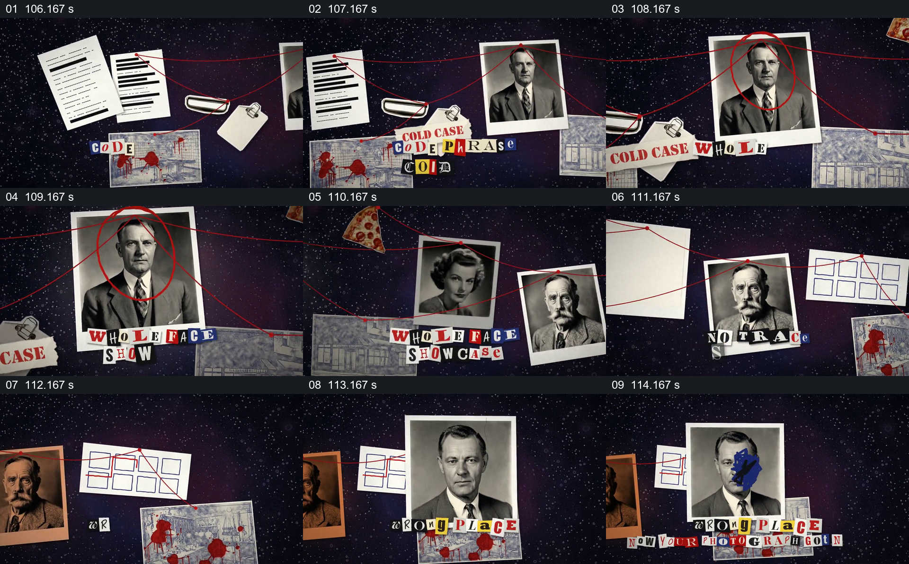

# 让红线跨过文件和肖像，再将注意集中到被覆盖的脸

- 作品：案例 013《拼贴影像、旧纸与字体》（库内索引名）。
- 原片范围：01:46.000–01:55.000，含起点、不含终点；[完整原片](../video.mp4)｜[本卡片段](c08.mp4)，片段起点对应原片 106.000 秒。
- 范围依据：红线网络与肖像聚焦共同构成关系板；随后换停车场。
- 观察方式：核看全片 64 帧总览和本卡九宫格；未独立连续原速观看和听审，快切、动作和声音关系待核，迁移尚未实测。人物、票据与监控界面均仅按虚构作品画面描述，不视为真实事件。

## 原画面具体怎样设计

深色星点背景上出现带黑色遮盖条的文件、夹子、人物照片、店面与室内图片；细红线从不同红点延伸，把多个对象连在同一画面。视野依次显示被红圈圈住的男士肖像、女性及另一名人物；末尾另一张男性肖像移到中央，蓝色笔迹遮住面部，底部仍有不同字体的剪报短句。

## 为什么这样设计，好在哪里

红线给分散素材共同的观看路径，肖像与场所共处一个可遍历的板面；随后扩大的人像从网络中取得主要注意。若只罗列照片而没有清楚的连接与焦点，观众难以知道此段在组织关系。线条只表达虚构的视觉关联，并不证明身份或事实。

## 可直接使用的创意指令

先确定需要同时呈现的少量角色、地点和文档，将它们放在共同承载空间中，以清楚的视觉线索建立经过确认或明确虚构的关系。先让观众认识整体，再选取最关键对象进入近景，保留部分先前网络作为参照。连线、照片和遮挡样式可以更换；现实材料不得用装饰性红线暗示未经核实的联系。
