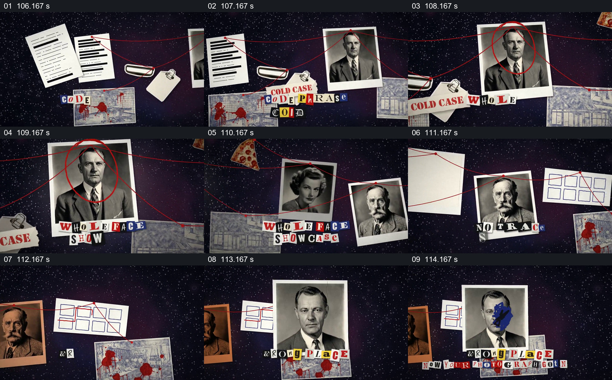

# 红线在照片、文件与地图之间形成线索板

- 作品：案例 013《拼贴影像、旧纸与字体》（索引名称）。
- 原片范围：01:46.000–01:55.000，含起点、不含终点；[完整原片](../video.mp4)｜[本卡片段](c08.mp4)。
- 观察方式：依据整片 64 宫格和约每秒一次的真实源帧观察，未连续原速观看或听审；声音、语气与完整播放节奏未确认。

## 原画面具体怎样设计

深色背景上出现纸张、票据和店面图，红线从一侧延伸到人物肖像，脸部被红圈标出；其他肖像和简化方格图依次进入，剪报字在下方变化。最后一张人物照片被蓝色图形遮住部分脸。

## 为什么这样设计，好在哪里

线条把分散材料组织成可追踪的关系网络，放大人物与圈注引导注意；同时保留文件、地点与照片，使画面呈现调查板的外观。它只展示作品中的构图，不证明任何人物关系或事件。

以上为依据画面的分析，非作者自述；预期观看效果未经观众测试。

## 可直接使用的创意指令

当确实需要展示多份材料之间已有的关系时，先核对每项材料身份和关系依据，再让文件、人物和位置图按阅读顺序进入；用线条或圈注连接具体、可解释的对应项，给重点材料足够尺寸，保留可追溯来源。纯虚构作品应明确虚构，不能让视觉连线制造现实指控。
