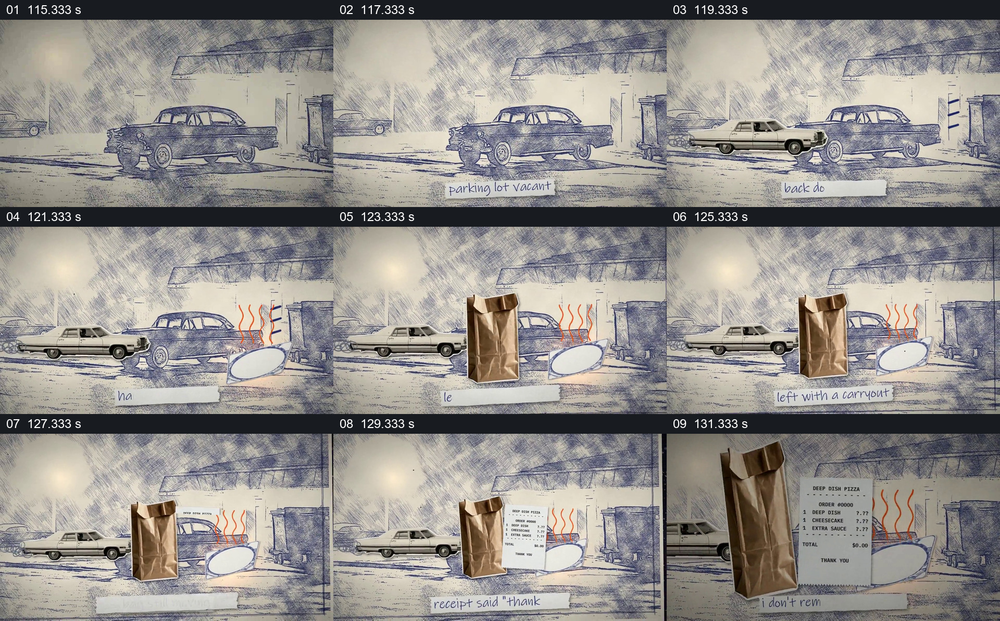

# 停车场保持不变，外卖袋与收据逐项出现

- 作品：案例 013《拼贴影像、旧纸与字体》（索引名称）。
- 原片范围：01:55.000–02:13.000，含起点、不含终点；[完整原片](../video.mp4)｜[本卡片段](c09.mp4)。
- 观察方式：依据整片 64 宫格和约每秒一次的真实源帧观察，未连续原速观看或听审；声音、语气与完整播放节奏未确认。

## 原画面具体怎样设计

蓝灰线描停车场里有汽车，之后另一辆车出现；右侧出现热气形状和纸袋。下方纸条文字随着场面变化，收据从纸袋旁加入并逐渐放大，能看到披萨、甜点、酱料等订单项目，随后切回漂浮物和标题。

## 为什么这样设计，好在哪里

汽车与背景保持，为后加的纸袋与收据提供位置参照；最后放大收据，让前面只是道具的纸张成为需要阅读的具体信息。收据是作品中的设计，金额和订单内容并未验证。

以上为依据画面的分析，非作者自述；预期观看效果未经观众测试。

## 可直接使用的创意指令

当需要让一张文件从场景道具变成关注重点时，先建立稳定场所和与文件有关的对象，按实际顺序加入袋子、票据或其他线索；保留对象关系，然后放大文件中与叙述有关的部分并给出阅读时间。事实题材须使用真实、可引用的文件并保留上下文；虚构票据须明确为示意。
