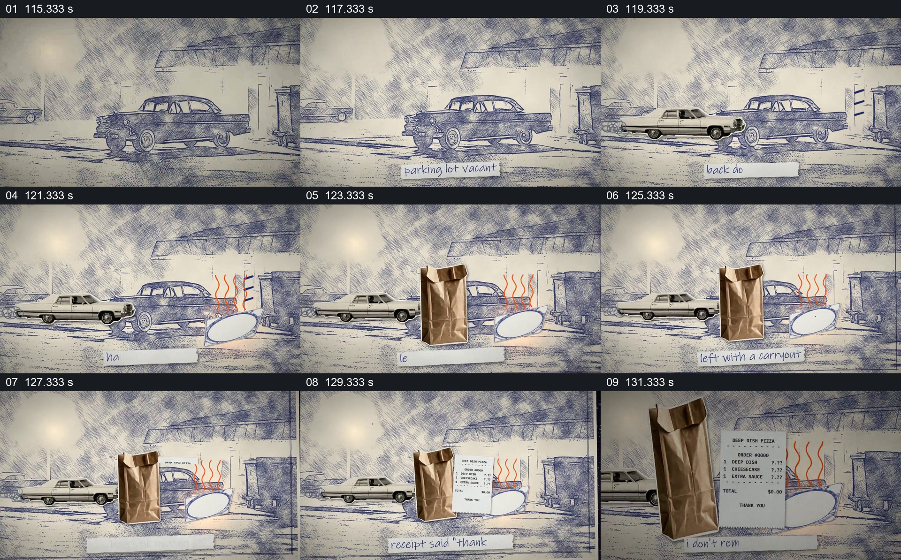

# 在停车场中逐步加入纸袋与票据，再放大收据

- 作品：案例 013《拼贴影像、旧纸与字体》（库内索引名）。
- 原片范围：01:55.000–02:13.000，含起点、不含终点；[完整原片](../video.mp4)｜[本卡片段](c09.mp4)，片段起点对应原片 115.000 秒。
- 范围依据：停车场、纸袋、票据与票据放大共同完成结尾线索。
- 观察方式：核看全片 64 帧总览和本卡九宫格；未独立连续原速观看和听审，快切、动作和声音关系待核，迁移尚未实测。人物、票据与监控界面均仅按虚构作品画面描述，不视为真实事件。

## 原画面具体怎样设计

蓝色线稿停车场中先有一辆深色汽车，随后另一辆浅色汽车出现在前景；橙色热气线和白色盘状物位于右侧。牛皮纸袋落到中间并保留，一张小票在袋旁显露。末段纸袋和小票共同放大，小票列出 DEEP DISH、CHEESECAKE 等项目与 $0.00 总计，底部手写文字仍继续。

## 为什么这样设计，好在哪里

汽车与停车场持续提供地点参照，纸袋和热气先建立外带情境，再由票据交代可读信息；票据从小到大取得注意，使细节成为该段的收束。票据是作品中的道具，不可当作真实交易记录。

## 可直接使用的创意指令

需要用实物线索收尾时，先建立可辨认的场所，再依次加入与场所有明确关系的携带物及信息载体；在不突然丢失环境的情况下放大最重要的单件，让观众读清结果。车辆、纸袋、收据与文字样式可替换；需要保留地点—实物—可读结果的先后关系。
