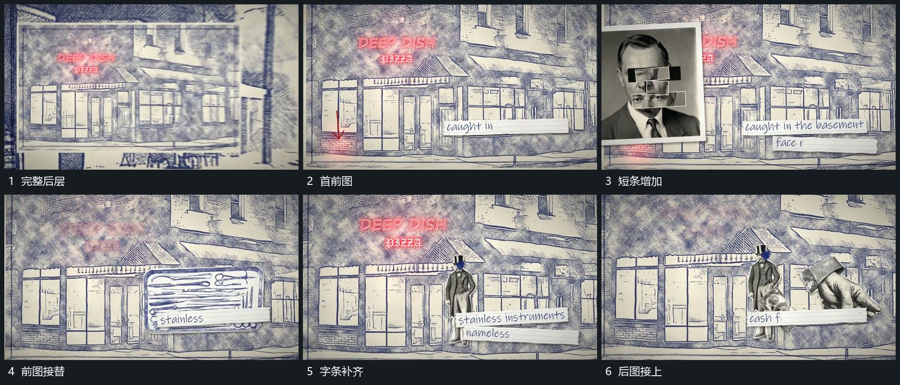

# 固定后层中前图逐次接替，底部短条逐字补齐

## 运动指令

保留完整后层，在前层接入一个图块，底部短条沿阅读方向逐字增加。下一图块在前层接替，后层保持，短条在同一承载位置继续更新，形成图到字、再到下一图的接续。

## 视频切片

[播放本机制的原片切片](m02.mp4)

覆盖分镜中“完整后层”至“后图接上”的连续过程，并保留邻近的前后衔接画面；原片中交叠发生的动作一并保留。

## 分镜过程

## 组合与调整

图块可用任意材料，记录可见替换，不规定原素材题材。
