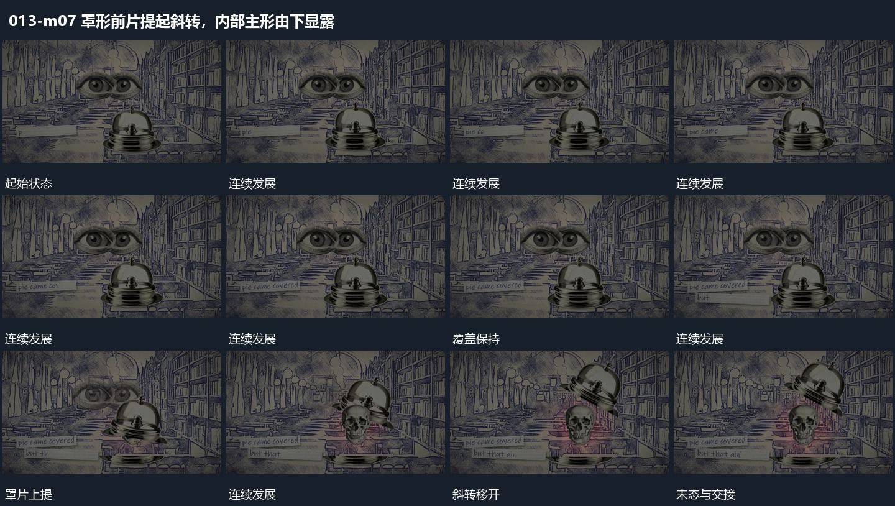

# 罩形前片提起斜转，内部主形由下显露

## 运动指令

保留下部承载面，将罩形前片先向上提起，再斜转到侧上方。内部主形在让出的范围中逐步显露，底层与旁侧文字位置保持，罩片最终离开主要视区。

## 视频切片

[播放本机制的原片切片](m07.mp4)

保留起始准备、连续发展和完成或明确交接；首尾按本段运动范围裁切，不拼接、不变速。尾部只保留理解结果所需的展示。

## 分镜过程

## 组合与调整

罩片可换任何遮挡平面。内部主形应一直在被遮位置，不随罩片一同上移。
