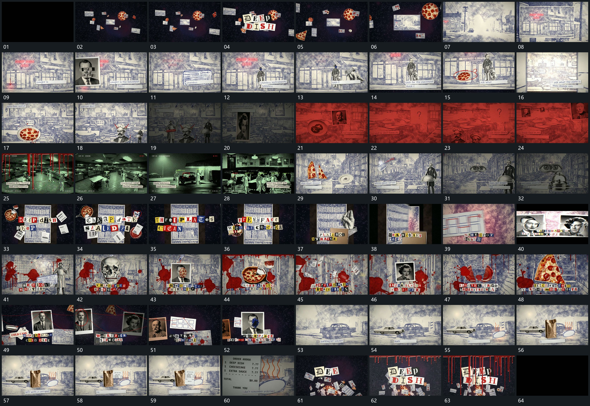

# 013｜原片运动总览

[观看完整原片](video.mp4)

## 运动总览

开头 散片建立远近空间，字片组出现后推入一张平面 将散片接入一个有远近的空间，中央字片逐项组合，再从选定平面推入满幅。固定后层中前图逐次接替，底部短条逐字补齐 在稳定后层中轮换前景图块，底部文字条逐字接续；局部描线与圈形短标记穿插出现。

中段画面按不同底层接替，罩形前片提起斜转，内部主形由下显露 把罩形片提起并斜转移开，内部主形显露。随后 多张字片按顺序落成多行，周边散片继续经过 将字片按阅读顺序落成多行，周边散片保持活动。附属件在竖片前接入，竖片绕侧边打开显出后层 在竖片前补入附属件，再让竖片绕侧边打开，后层空间显露。后段重用 固定后层中前图逐次接替，底部短条逐字补齐 轮换前图，散片之间细线延伸，连接到多个已有局部 以细线连接散开的片，形成可追踪关联。

末段 前层片错开接入，镜头侧移后推近局部，再返回集合 在保持后层的同时让前层片错开进入，从侧移到局部推近；再退回集合空间，字片组建立，细长条自上向下延长，最终退出。

## 完整运动段落

以下按原片中的出现顺序引用。建立、内部发展及完成反馈放在同一段中；同时发生的局部动作与运镜写在同一份指令里。不同段之间可以是连续接管，也可以是直接切换，不能仅凭条目相邻认定可直接拼接。重复出现的同类运动采用一次连续代表范围，切片不以逐段无缝覆盖整片为目标。

1. [散片建立远近空间，字片组出现后推入一张平面](mechanisms/m01.md)：散片先建立，字组后到，镜头再推进

2. [固定后层中前图逐次接替，底部短条逐字补齐](mechanisms/m02.md)：前图更新，后层与短条位置保持

3. [罩形前片提起斜转，内部主形由下显露](mechanisms/m07.md)：先上提，再斜转让出内部

4. [多张字片按顺序落成多行，周边散片继续经过](mechanisms/m03.md)：字片分项建立，后层持续

5. [附属件在竖片前接入，竖片绕侧边打开显出后层](mechanisms/m04.md)：附属件先补，片面随后打开

6. [散片之间细线延伸，连接到多个已有局部](mechanisms/m05.md)：片先在，线随后连接

7. [前层片错开接入，镜头侧移后推近局部，再返回集合](mechanisms/m06.md)：片先入场，镜头再选择局部

切片保留起始准备、必要内部停顿和完成或明确交接；首尾省略无新发展的等待，持续运动不要求人为停住。以上基于真实源帧序列和重点边界核对，不等同于全片连续声画审片。

## 完整64宫格

