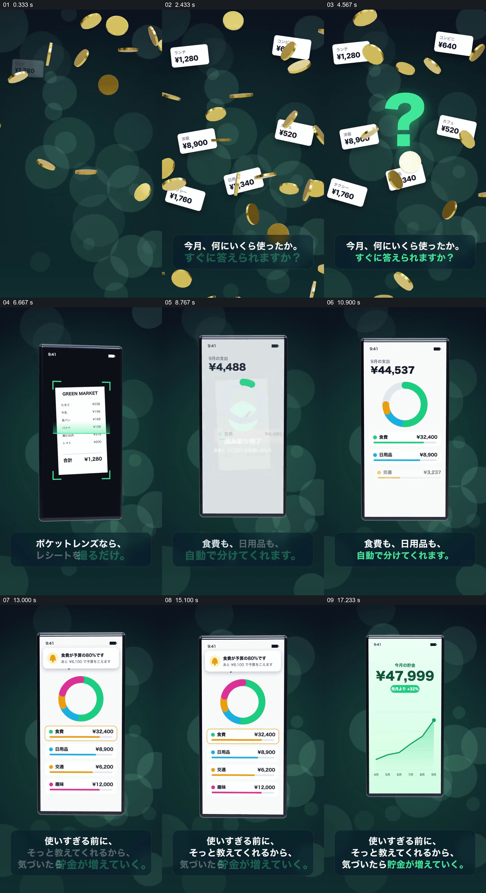

# 从散落支出到同一手机里的分类、提醒和趋势

- 作品：案例 041《手机财务图表与空间组合》（库内索引名）。
- 原片范围：00:00.000–00:19.000，含起点、不含终点；[完整原片](../video.mp4)｜[本卡片段](c01.mp4)，片段起点对应原片 0.000 秒。
- 范围依据：0–19 秒从散落支出、输入与分类发展到提醒和趋势结果，共同完成一套“看清支出”的说明；后面转为品牌口号和下载提示，不另建卡。
- 观察方式：核看全片 64 帧总览及本卡九宫格；未独立连续原速观看，快速变化和运动节奏待核。未独立听审，声音内容未知。片中事实和演示未独立查证，新题材迁移尚未实测。

## 原画面具体怎样设计

深青绿色虚化圆斑上散布许多金色硬币，白色小卡分布在不同位置，各写午餐、便利店、衣服等金额；下方文字提出“这个月各花了多少，能马上回答吗”，中央再出现绿色问号。抽样画面显示这些金额卡与金币占据整个竖画幅，尚没有一个统一总数。

随后画面换为居中的手机：收据位于屏幕中，四角绿色取景框围住纸张，绿色扫描带出现在收据不同高度，随后有绿色对号与完成提示。手机外的底色和底部说明仍保持相似位置。手机屏幕再换为白色账单统计：顶部金额、彩色环图和下方不同颜色的分类条目逐步出现；接着顶部提示条与餐费条目的黄色边框形成对应，指出预算接近上限。最后同一位置出现储蓄金额与向上的折线图，底部仍是短句说明。视频中的单据金额、分类总额和储蓄曲线都是演示画面，不能据此认定前者计算出后者。

## 为什么这样设计，好在哪里

开头不是直接给观众一张图表，而是先让多个用途与金额分散在全屏，让“钱花到哪里”成为可以看见的问题；中央问号把分散项目收为同一个疑问。后面用居中手机持续承载扫描、分类、提醒与趋势：每次屏幕内容变化时，设备和背景仍提供参照，观众容易把它们理解为同一产品演示中的不同阶段。扫描后的对号先给出处理完成的可见反馈，彩色环图再把分项放在一起，而预警条与对应分类行建立明确指向，趋势页则提供时间维度的结果。

关键是先呈现具体分散项，再提供可辨的输入、完成反馈及能回看的结果；只展示漂亮的环图会丢失问题与来源之间的关系。图表、圆斑、硬币造型是本片的选择。这里是基于画面的分析，不是对实际识别能力、储蓄效果的验证，也非作者自述。

## 完整照排指令

以[完整原片](../video.mp4)的 0–19 秒为准。画幅 720×1280，源帧率 30/1。以下拍点为抽帧定位，位置按画幅百分比取近似值。

### 用料

【支出金额组】【收据画面】【分类总额】【分类记录组】【提醒短句】【趋势终值】【趋势折线】取同一记账样例。若展示真实识别或金额，提供可核对的收据、分类规则和时间范围。备【开场问句】【扫描短句】【分类短句】【收束句】【结束标记】。收据隐藏无关私人字段。

### 按源时刻摆放

1. **0–约 5 秒。** 深绿黑底铺柔焦圆斑，金色币形从上方与侧缘斜漂。分散白色短纸签【支出金额组】，字用小粗黑，各有倾角，保持完整币种。画底深绿色半透明条中央排白【开场问句】，后半句可提亮青绿；较大的同色问号短居右上。币形可无缝循环，金额首次入画不重置。
2. **约 5–9 秒。** 纸签移出，中轴竖手机黑壳从下接入。内屏中央置浅白【收据画面】，四角短青线贴收据边界。保持同一收据至绿色确认勾覆盖，下方留小【扫描短句】。真实扫描若用实拍，保留收据从可见到识别完成的连续段；确认后可固定当次画面。
3. **约 9–16 秒。** 手机框稳定，内屏切亮白，上方粗黑【分类总额】，下方先形成一段薄荷绿圆环，再增加蓝、黄、粉分类。各自的【分类记录组】在圆环下依序左齐增行，金额右齐。手机下方留暗条【分类短句】。约 13 秒后内屏顶部加入浅黄标和【提醒短句】，原圆环与分类保持，切换时不能先清除数据。
4. **约 16–19 秒。** 白分类版让给同框浅绿趋势页，粗黑【趋势终值】配下半青绿【趋势折线】，依据实际点位逐次推进。末拍渐青手机内以浅色【结束标记】居中，周边再露金色币形，画底以白色【收束句】短留，到 19.000 秒切出。

### 局部采用

只有同源收据及分类可用约 5–13 秒，结束于完整分类显示。只有已核对的趋势记录可用约 16–19 秒，缺点位时采用静态面板。

### 验证状态

已对照逐秒原片画序并读回，核对收据到确认、圆环与分类逐次加项、提醒叠在分类上，以及趋势接到青屏。精确状态帧、数字原字及换料试摆待核。
