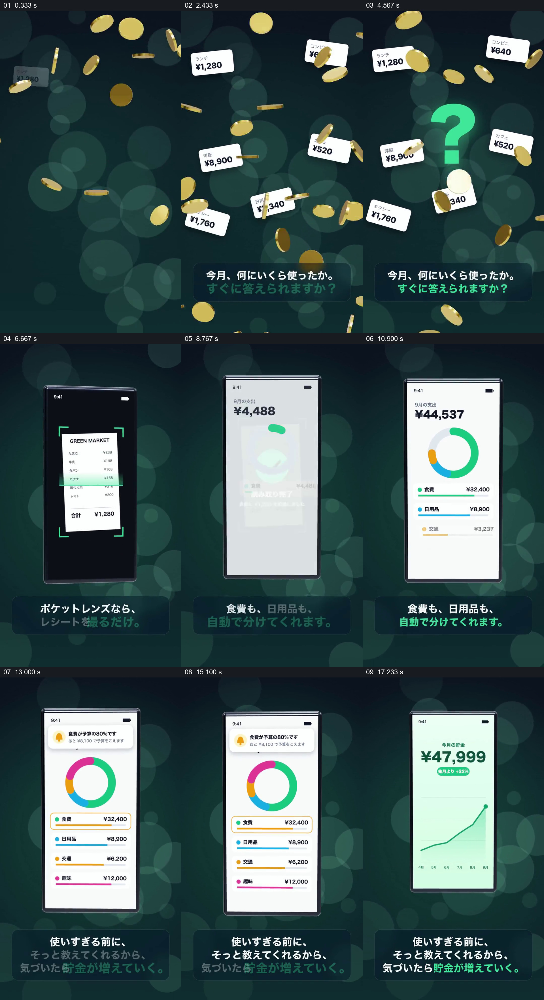

# 从散落支出到同一手机里的分类、提醒和趋势

- 作品：案例 041《手机财务图表与空间组合》（库内索引名）。
- 原片范围：00:00.000–00:19.000，含起点、不含终点；[完整原片](../video.mp4)｜[本卡片段](c01.mp4)，片段起点对应原片 0.000 秒。
- 范围依据：0–19 秒从散落支出、输入与分类发展到提醒和趋势结果，共同完成一套“看清支出”的说明；后面转为品牌口号和下载提示，不另建卡。
- 观察方式：核看全片 64 帧总览及本卡九宫格；未独立连续原速观看，快速变化和运动节奏待核。未独立听审，声音内容未知。片中事实和演示未独立查证，新题材迁移尚未实测。

## 原画面具体怎样设计

深青绿色虚化圆斑上散布许多金色硬币，白色小卡分布在不同位置，各写午餐、便利店、衣服等金额；下方文字提出“这个月各花了多少，能马上回答吗”，中央再出现绿色问号。抽样画面显示这些金额卡与金币占据整个竖画幅，尚没有一个统一总数。

随后画面换为居中的手机：收据位于屏幕中，四角绿色取景框围住纸张，绿色扫描带出现在收据不同高度，随后有绿色对号与完成提示。手机外的底色和底部说明仍保持相似位置。手机屏幕再换为白色账单统计：顶部金额、彩色环图和下方不同颜色的分类条目逐步出现；接着顶部提示条与餐费条目的黄色边框形成对应，指出预算接近上限。最后同一位置出现储蓄金额与向上的折线图，底部仍是短句说明。视频中的单据金额、分类总额和储蓄曲线都是演示画面，不能据此认定前者计算出后者。

## 为什么这样设计，好在哪里

开头不是直接给观众一张图表，而是先让多个用途与金额分散在全屏，让“钱花到哪里”成为可以看见的问题；中央问号把分散项目收为同一个疑问。后面用居中手机持续承载扫描、分类、提醒与趋势：每次屏幕内容变化时，设备和背景仍提供参照，观众容易把它们理解为同一产品演示中的不同阶段。扫描后的对号先给出处理完成的可见反馈，彩色环图再把分项放在一起，而预警条与对应分类行建立明确指向，趋势页则提供时间维度的结果。

关键是先呈现具体分散项，再提供可辨的输入、完成反馈及能回看的结果；只展示漂亮的环图会丢失问题与来源之间的关系。图表、圆斑、硬币造型是本片的选择。这里是基于画面的分析，不是对实际识别能力、储蓄效果的验证，也非作者自述。

## 可直接使用的创意指令

适合解释零散记录如何进入可管理的总览：准备经授权或模拟的具体条目、一个可读的录入材料，以及能与这些材料对应的分类和结果页面。先把若干不同条目分散在画面中，结合一句真实的问题说明整理难点；再明确显示一个有代表性的输入过程和完成反馈，让观看者知道材料怎样进入系统。以同一设备或固定画面容器承接汇总，逐步呈现分类、总数和需要注意的项目；如有真实的时间数据，再转到趋势结果，并标明范围、单位和统计口径。分散对象、设备形式、色彩和图形均可替换，但应保留材料到结果的可追踪关系；示意动画不能冒充真实识别、精确计算或由应用直接带来的财务收益。
