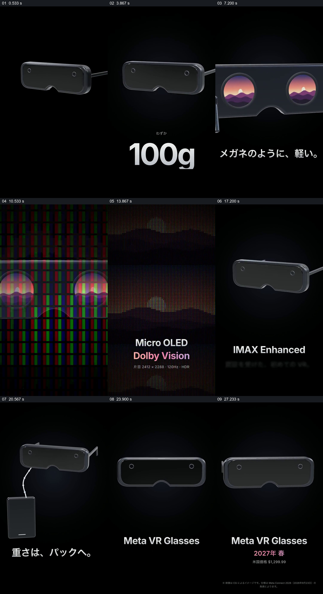

# 围绕同一设备依次显露重量、观看体验与结构

- 作品：案例 091《轻量头戴设备展示》（本次概括）。
- 原片范围：00:00.000–00:30.058，含起点、不含终点；[完整原片](../video.mp4)｜[本卡片段](../video.mp4)。
- 观察方式：依据约每秒一次的真实源帧观察，未连续原速观看或听审；声音、语气与完整播放节奏未确认。

## 原画面具体怎样设计

黑色竖屏中央始终以头戴设备为主，先出现 100g；设备转向侧面后画面靠近镜片，镜片里出现日落，画面又扩展为对应景象。像素阵列和 Micro OLED、Dolby Vision 文字随后出现，设备重新回到黑底，再以线缆连接外部盒子；最后是正面产品、名称与日期。

## 为什么这样设计，好在哪里

同一设备反复返回，帮助观众把重量、画面体验及连接关系归到同一个对象上；镜片内外相似的景象让观看体验获得直观对应。设备规格与上市信息是片中陈述，未经核实。

以上为依据画面的分析，非作者自述；预期观看效果未经观众测试。

## 可直接使用的创意指令

介绍设备的多个相关特征时，先保留完整产品作为参照，针对每项特征切近对应部件或使用视角，再回到整体；展示连接关系时保留线缆和外部装置。参数、功能和发布时间应以实际资料核对。
