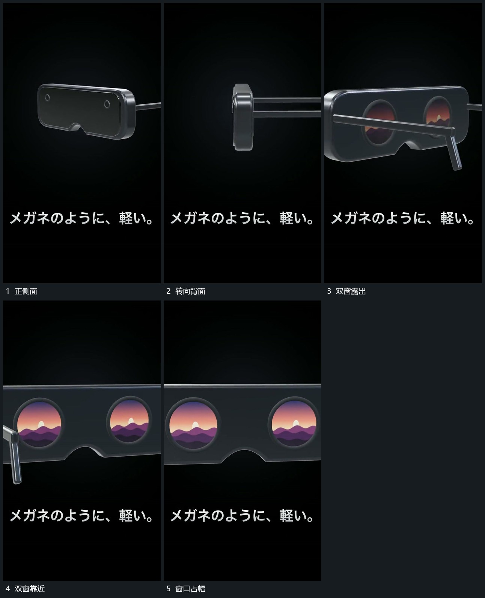

# 厚片转向背面并推近双圆窗口

## 运动指令

继续转向厚片背侧，在转角中推近，使双圆窗口逐步露出并扩大。外缘和侧端部先后越界，窗口内部保持同一图层来源；到主要范围后收小转角，只保留内部局部变化。

## 视频切片

[播放本机制的原片切片](m02.mp4)

覆盖分镜中“正侧面”至“窗口占幅”的连续过程，并保留邻近的前后衔接画面；原片中交叠发生的动作一并保留。

## 分镜过程

## 组合与调整

转角与靠近连续发生，不能先消失正面再跳出背面；内部内容由新片重新选择。
