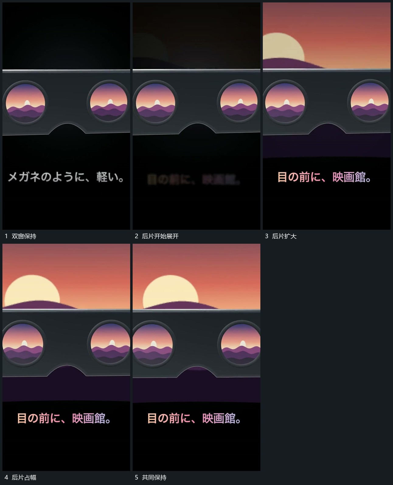

# 后方片面从双窗之间扩大形成尺度接续

## 运动指令

保留前层双圆窗口，从窗口之间的后方逐步展开一张更大矩形片。后片内部与窗口内的图层位置相近，扩大时露出更宽范围；前层窗口和厚片边界仍保持，形成由小窗到大面的连续尺度变化。

## 视频切片

[播放本机制的原片切片](m03.mp4)

覆盖分镜中“双窗保持”至“共同保持”的连续过程，并保留邻近的前后衔接画面；原片中交叠发生的动作一并保留。

## 分镜过程

## 组合与调整

后片可以只展开一侧；保持内外图层的来源关系，避免两处内容各自独立跳动。
