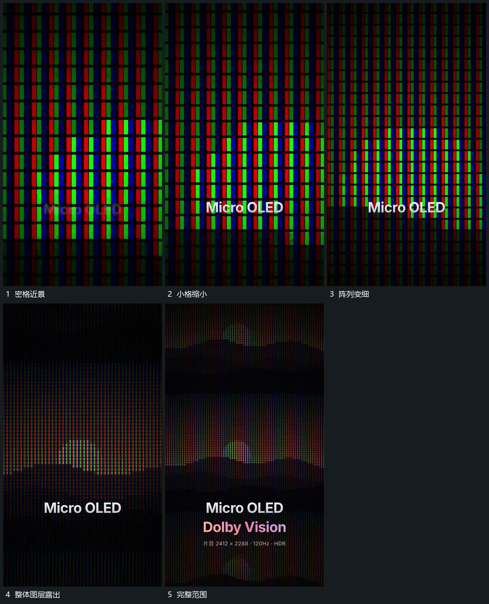

# 密集小格近景退镜逐步露出整体图层

## 运动指令

从密集小格的近景持续后退，让每格逐步缩小、数量在画面中增加。格间内容同时形成更大整体图层，后退到稳定范围后才补下方短行。整个过程中保留同一格列关系，不在缩小中更换另一套排列。

## 视频切片

[播放本机制的原片切片](m04.mp4)

覆盖分镜中“密格近景”至“完整范围”的连续过程，并保留邻近的前后衔接画面；原片中交叠发生的动作一并保留。

## 分镜过程

## 组合与调整

只借鉴尺度接续，不把小格外观当成真实技术证明；不同新片可用其他规则阵列。
