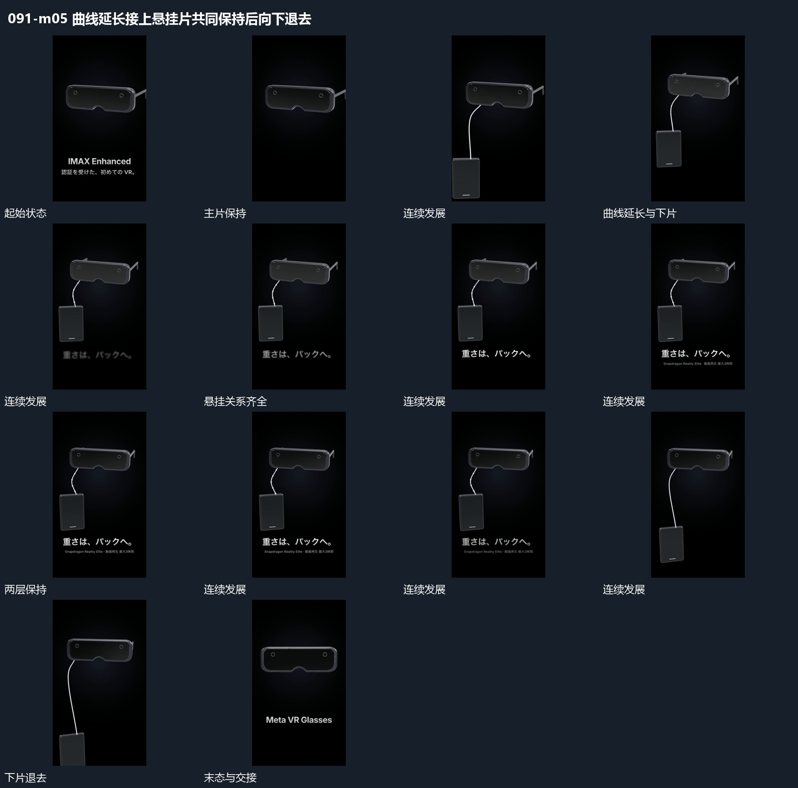

# 曲线延长接上悬挂片共同保持后向下退去

## 运动指令

从主片下缘延长曲线，曲线末端接入竖片，下片带小倾角摆动，主片保持。两层关系完整后，下片和相连曲线沿下方逐步退出，主片重新调整到中央稳定范围，下方主行与附属行依次接入。

## 视频切片

[播放本机制的原片切片](m05.mp4)

覆盖分镜中“主片保持”至“主片独立”的连续过程，并保留邻近的前后衔接画面；原片中交叠发生的动作一并保留。

## 分镜过程

## 组合与调整

曲线端点始终连接两片；下片退出时只释放该支路，不让主片一起离场。
