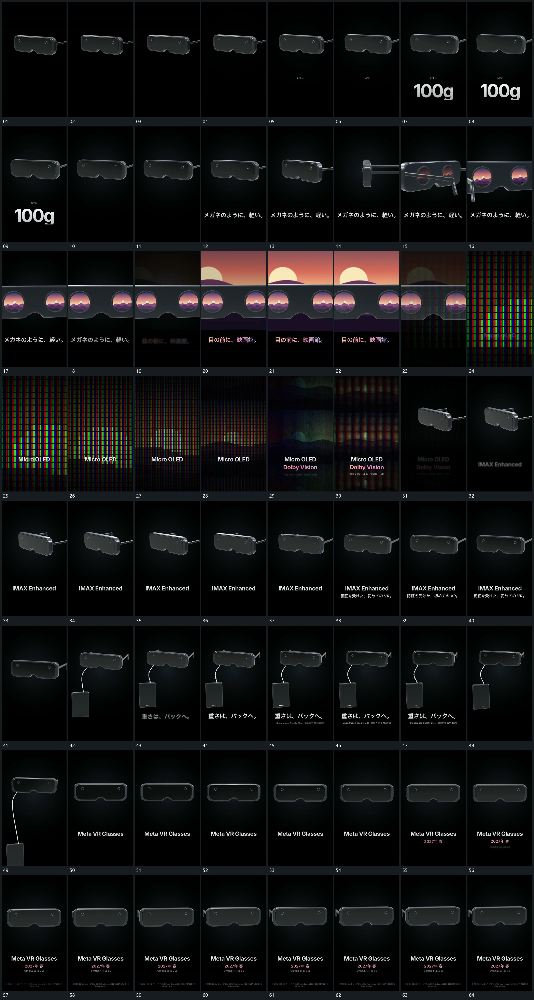

# 091｜原片运动总览

[观看完整原片](video.mp4)

## 运动总览

全片以横向厚片缓慢转角字行依次建立让横向厚片在同一范围缓慢转角，字行分项接入。随后厚片转向背面并推近双圆窗口进一步转向背面并靠近，原厚片内的双圆窗口保持同一内容来源。后方片面从双窗之间扩大形成尺度接续在其后方扩大片面，让窗口与后片产生尺度接续。

之后密集小格近景退镜逐步露出整体图层由密集小格近景逐步退到整体图层，再回到原厚片的全貌。后段复用横向厚片缓慢转角字行依次建立，曲线延长接上悬挂片共同保持后向下退去在厚片下方建立曲线与悬挂片，并沿下方退出，主片留在中央，结尾字行依次补齐。

## 完整运动段落

以下按原片中的出现顺序引用。建立、内部发展及完成反馈放在同一段中；同时发生的局部动作与运镜写在同一份指令里。不同段之间可以是连续接管，也可以是直接切换，不能仅凭条目相邻认定可直接拼接。重复出现的同类运动采用一次连续代表范围，切片不以逐段无缝覆盖整片为目标。

1. [横向厚片缓慢转角字行依次建立](mechanisms/m01.md)：转角持续附属行接入

2. [厚片转向背面并推近双窗，后方平面扩大接管](mechanisms/m06.md)：厚片先转向背面并推近，双圆窗口显出；后方平面从两窗之间向外扩大，形成尺度与观看范围的接替。

3. [密集小格近景退镜逐步露出整体图层](mechanisms/m04.md)：阵列缩小整体显露

4. [曲线延长接上悬挂片共同保持后向下退去](mechanisms/m05.md)：延线接片后下退

切片保留起始准备、必要内部停顿和完成或明确交接；首尾省略无新发展的等待，持续运动不要求人为停住。以上基于真实源帧序列和重点边界核对，不等同于全片连续声画审片。

## 完整64宫格

