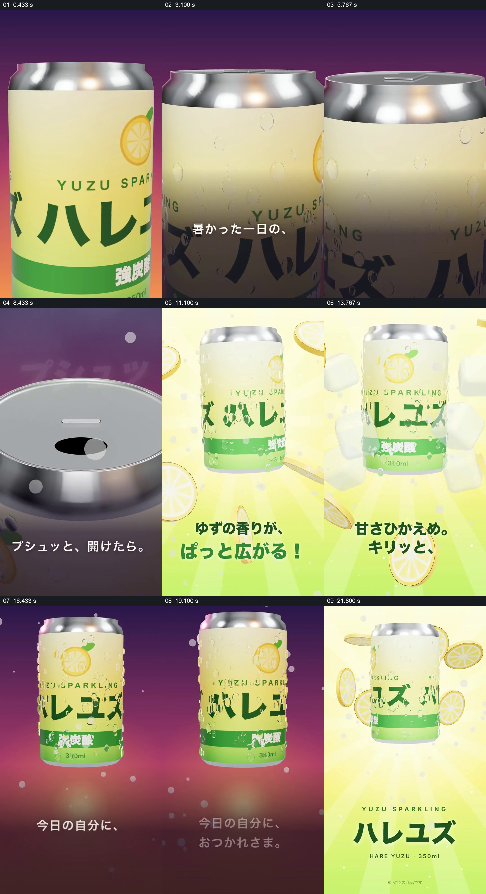

# 以开罐为转折，让同一饮料进入明亮风味空间

- 作品：案例 092。
- 原片范围：00:00.000–00:24.042（源时间，起点包含、终点不包含）；[完整原片](../video.mp4)｜[本卡片段](../video.mp4)。范围覆盖整片，直接引用原片和现有分镜。
- 观察方式与未确认范围：查看完整原片 64 帧总览和本卡分镜。未独立连续原速观看及听审，采样间动作、精确速度、声音与同步未确认；以下价值判断为作品分析，迁移尚未实测。

## 原画面具体怎样设计

竖画幅中，罐身在紫色渐变背景前占据大部分面积；黄色标签、绿色字与水果图形可见，随后有水滴分布在罐面。画内出现日文短句，观察位置向罐顶变化；约 00:08，罐口已打开，顶部有白色拟声文字及圆点。

接下来背景变为明亮的黄绿色放射空间，罐体缩到中间，周围出现柚子切片、冰块和气泡，下方绿色日文短句分阶段更换。之后罐体回到较暗紫红背景，下面出现另一句文字；末尾再次切回亮色背景，产品位于上方，名称及容量放在下方，底部有“架空の商品です”字样。

## 为什么这样设计，好在哪里

前半段先让观众接近罐身材质和顶部，再以开口作为视觉状态变化的节点；水果、冰块、放射背景和气泡共同把注意力从包装转向片中设计的风味想象。罐体在不同背景里保持类似标签和形状，因而从暗到亮的变化仍围绕同一对象。

回到较暗背景后再给出亮色产品收尾，使最后名称拥有清楚的阅读位置。开口动作、气泡与声音是否同步没有听审；片末标明是虚构商品，不能把风味和规格当成真实商品信息。
