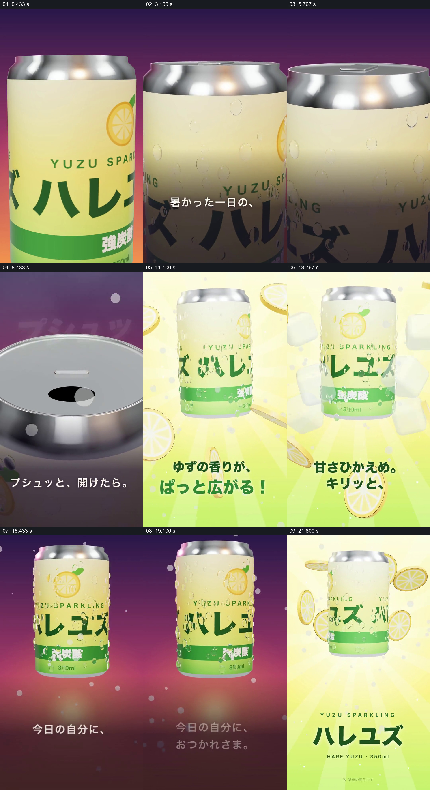

# 以开罐为转折，让产品从暗色进入明亮的风味空间

- 作品：案例 092《柚子汽水的开罐体验》（本次概括）。
- 原片范围：00:00.000–00:24.042，含起点、不含终点；[完整原片](../video.mp4)｜[本卡片段](../video.mp4)。
- 观察方式：依据约每秒一次的真实源帧观察，未连续原速观看或听审；声音、语气与完整播放节奏未确认。

## 原画面具体怎样设计

竖屏中罐身在暗紫背景上占据画面，镜头靠近罐顶，开口出现并显示拟声文字；接着亮光铺满画面，整罐悬在黄绿色背景中，柚子切片与冰块围绕，文字逐项介绍香气、甜度与气泡。画面短暂转暗并配一句慰劳自己的文字，最后回到亮色背景与产品名称。

## 为什么这样设计，好在哪里

开罐前后的亮度和素材变化把抽象风味变成可见体验；罐身贯穿变化，保证柚子、冰和文字都指向同一产品。口感和配料是片中呈现，未品尝或核验。

以上为依据画面的分析，非作者自述；预期观看效果未经观众测试。

## 可直接使用的创意指令

展示饮品或食品体验时，先给出清楚的包装及开启动作，让开启成为画面变化的触发点；将真实产品有关的材料与感受文字围绕同一产品展开，再回到完整包装与名称。味道、配料和宣传主张应依据产品资料。
