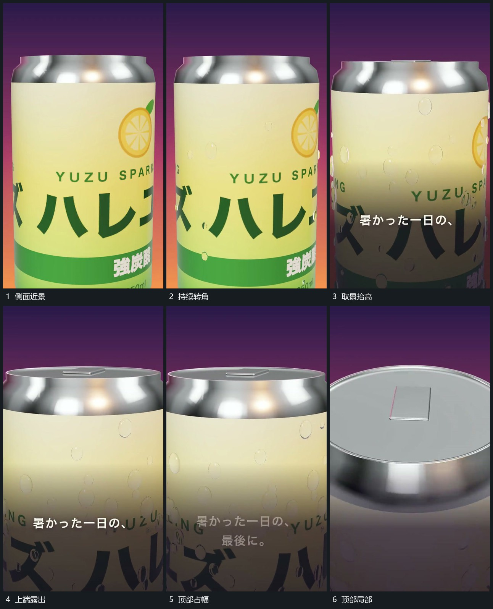

# 圆柱持续转角取景逐步抬到顶部

## 运动指令

让圆柱围自身轴缓慢转动，表面图层随圆柱一起经过。取景同时向上移动，先露出顶部边缘，再靠近上端平面；侧面逐步退到下部，前层短行可在原位接替。

## 视频切片

[播放本机制的原片切片](m01.mp4)

覆盖分镜中“侧面近景”至“顶部局部”的连续过程，并保留邻近的前后衔接画面；原片中交叠发生的动作一并保留。

## 分镜过程

## 组合与调整

任何有上下端的主形均可采用；取景和旋转分别控制，保持表面图层不滑脱。
