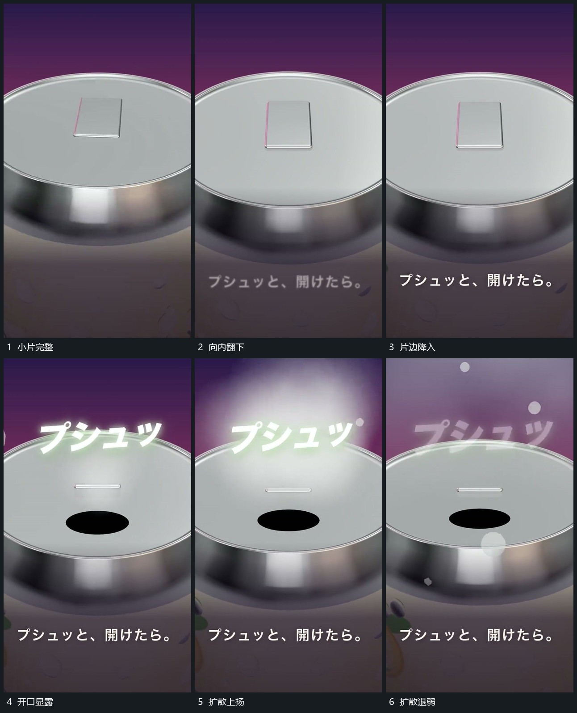

# 顶端小片向内翻下开口向上扩散

## 运动指令

保持顶部外缘，让局部小片围一边向内翻下，空出的范围逐渐露成开口。开口上方接出短线、小点和模糊团，向上升起并扩大；小片落入后保持，扩散退弱时取景开始回到完整主形。

## 视频切片

[播放本机制的原片切片](m02.mp4)

覆盖分镜中“小片完整”至“扩散退弱”的连续过程，并保留邻近的前后衔接画面；原片中交叠发生的动作一并保留。

## 分镜过程

## 组合与调整

扩散来源绑定开口，不能全幅随机发起；不要求保留原主体或声音含义。
