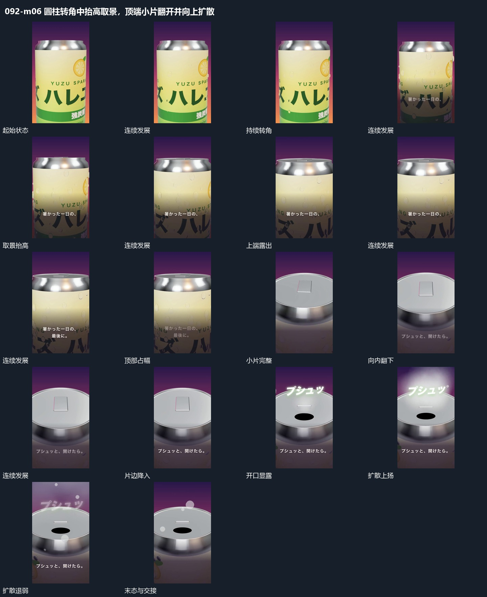

# 圆柱转角中抬高取景，顶端小片翻开并向上扩散

## 运动指令

圆柱持续转角，取景逐步抬到顶部；顶端小片向内翻开，开口向上喷散，形成完整揭示与反馈。

1. **圆柱持续转角取景逐步抬到顶部**

让圆柱围自身轴缓慢转动，表面图层随圆柱一起经过。取景同时向上移动，先露出顶部边缘，再靠近上端平面；侧面逐步退到下部，前层短行可在原位接替。

2. **顶端小片向内翻下开口向上扩散**

保持顶部外缘，让局部小片围一边向内翻下，空出的范围逐渐露成开口。开口上方接出短线、小点和模糊团，向上升起并扩大；小片落入后保持，扩散退弱时取景开始回到完整主形。

整段结束：开口露出且上方扩散退去 保留必要落稳与交接，中间已建立的参照沿用到下一步骤。

## 视频切片

[播放本机制的原片切片](m06.mp4)

保留起始准备、连续发展和完成或明确交接；首尾按本段运动范围裁切，不拼接、不变速。相连的小动作合为同一完整段落。

## 分镜过程

## 组合与调整

圆柱持续转角，取景逐步抬到顶部；顶端小片向内翻开，开口向上喷散，形成完整揭示与反馈。 复用时可调整元素数量、幅度和相对节奏，保留上述进入、交叠与完成关系；不直接沿用原片题材或时长。

任何有上下端的主形均可采用；取景和旋转分别控制，保持表面图层不滑脱。

扩散来源绑定开口，不能全幅随机发起；不要求保留原主体或声音含义。
