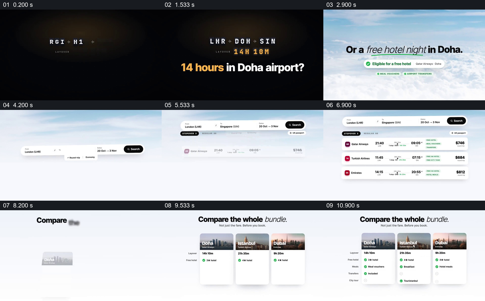

# 把转机等待改写成可比较的停留方案

- 作品：案例 021《城市影像与旅行数据》（索引名称）。
- 原片范围：00:00.000–00:12.000，含起点、不含终点；[完整原片](../video.mp4)｜[本卡片段](c01.mp4)。
- 观察方式：依据整片 64 宫格和约每秒一次的真实源帧观察，未连续原速观看或听审；声音、语气与完整播放节奏未确认。

## 原画面具体怎样设计

黑色画面先显示“14 hours in Doha airport?”，随后转为云层背景和“free hotel night”提示。搜索条填写出发地、目的地与日期，下面逐行出现航班结果；之后多哈、伊斯坦布尔和迪拜的三张城市卡同屏，逐项列出停留时长、酒店、餐食等内容。

## 为什么这样设计，好在哪里

开头先给观众一个具体等待情境，再将另一种可能接到可比较的选项；三张卡使用相同字段，使不同方案的条件可在同一位置对照。片中航班、价格和免费福利只是示例，不能视为当前政策。

以上为依据画面的分析，非作者自述；预期观看效果未经观众测试。

## 可直接使用的创意指令

当需要比较几种行程或服务方案时，先交代相同的出发条件和用户面临的问题，展示真实搜索结果或明确标注的演示；再把每个方案按同一组字段并列，例如时间、费用及包含服务。数据需给出来源、日期和适用条件，不以示例卡片保证实际福利。
