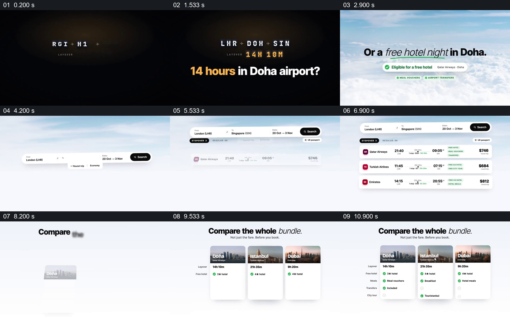

# 把漫长转机变成多目的地权益比较

- 作品：案例 021《航线影像与权益比较》（库内索引名称）。
- 原片范围：00:00.000–00:12.000，含起点、不含终点；[完整原片](../video.mp4)｜[本卡片段](c01.mp4)。
- 范围依据：从转机疑问、可替代结果到三列权益基本填满，下一段开始核查个人资格。
- 观察方式与未确认范围：查看整片 64 帧总览和本卡分镜。未独立完成连续原速观看与听审；抽帧之间的运动、停顿与声音配合待复核。画面中的界面、数字与说明是作品呈现，未经额外核实；设计价值为基于画面的分析。

## 原画面具体怎样设计

黑底中央先出现伦敦—多哈—新加坡的机场代码和 14 小时 10 分钟停留，大字提出“14 hours in Doha airport?”；随后背景切成明亮云层，“免费酒店一晚”及绿色资格标记取代疑问，形成前后相对的两种处境。

云层逐渐退为淡色背景，一条横向搜索框输入出发地、目的地和日期；下方陆续出现三条航班结果，每行分别保留航司、时刻、价格与绿色权益标签。接着这些列表让位于三张城市卡：多哈、伊斯坦布尔和迪拜的城市影像位于卡片上缘，停留时长、酒店、餐食、接送和城市游以统一行次填入。

到 10 秒后，三个卡片已能横向比较，伊斯坦布尔一列出现强调边框；下一段从这一选项继续核对是否满足条件。

## 为什么这样设计，好在哪里

同一场面先把“等待”具象化，再用相同航线中的替代权益改写这个问题；航班行让观众先知道选项来自搜索，三张城市卡再把散落在各行中的条件对齐，适合横向扫描。若只有目的地照片，没有统一的条件行，就看不出差异；若只有数字表，也会少掉城市与真实旅行处境的联系。

画面中的价格、权益和资格仅为该片演示，未经独立核实。

## 完整照排指令

以[完整原片](../video.mp4)的 0–12 秒为准。画幅 1280×720，源帧率 30/1。以下拍点为抽帧定位，位置按画幅百分比取近似值。

### 用料

【航线代码组】【候机时长】【中转地】【权益短句】【搜索条件组】【航班记录组】【城市照片组】【城市名称组】【比较项目组】【比较结果组】取同一旅行场景、时间和货币口径。各条权益与实际航班和城市对应，提供可打开的航司条件或带日期的搜索记录。另备【候机问题】【搜索提示】【比较标题】【比较附注】【邻段标题】。

### 按源时刻摆放

1. **0.000–约 2.000 秒。** 深黑机舱感底，中央上部疏排小白【航线代码组】，暖黄色【候机时长】次行。稍后中轴建大粗【候机问题】，时长暖黄，地点与其余词白色，保留一行清楚问题。
2. **约 2.000–4.500 秒。** 切浅蓝天空云层全幅。中部以黑粗及细斜词组表示【权益短句】，下方浅白圆角短签内用小绿标和细黑【搜索提示】。标题与云同屏。背景可轻移，不让亮云吞字。
3. **约 4.500–7.500 秒。** 云景仍做底，抬上白色横搜索条，等距排【搜索条件组】，右端小黑胶囊。其下依次加入白【航班记录组】结果行，从一条到三条。左端留小色块，右端价格粗黑，权益或状态用小绿文字。先前结果留至表格切走，不重排成不同查询。
4. **约 7.500–11.700 秒。** 浅白底，左上区域建黑粗【比较标题】与细【比较附注】。下方三列等宽卡，从左至右建立，顶端由各自【城市照片组】横裁加白【城市名称组】，下面用相同行高对应【比较项目组】和【比较结果组】，以小绿符号表示适用。三卡自到位至离场始终同屏，末段可用淡绿描边突出一列，不能减少其他列。照片允许定格，结果以同口径静态数据分层出现。
5. **约 11.700–12.000 秒。** 比较页交给近黑底的新【邻段标题】，按 12.000 秒切出。

### 局部采用

只有真实航班与条件可用约 4.500–7.500 秒；有两至三项同口径城市权益可用约 7.500–11.700 秒。只有单项优惠时不能采用跨目的地比较。

### 验证状态

已对照每秒两帧原片画序并读回，核对深底问题、云底及搜索、三列逐次建立与末拍暗底。具体票价和权益小字、精确切帧及换料待核。
