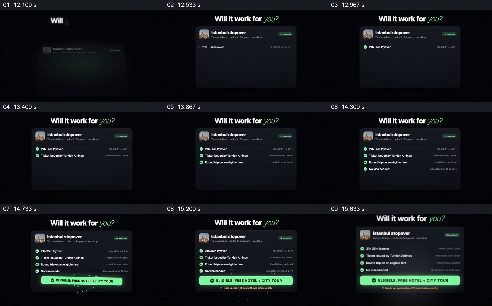

# 让一个候选通过逐项核对得到明确结论

- 作品：案例 021《航线影像与权益比较》（库内索引名称）。
- 原片范围：00:12.000–00:16.000，含起点、不含终点；[完整原片](../video.mp4)｜[本卡片段](c02.mp4)。
- 范围依据：从上一段选择的伊斯坦布尔接入，至条件、结论与注意事项显露。
- 观察方式与未确认范围：查看整片 64 帧总览和本卡分镜。未独立完成连续原速观看与听审；抽帧之间的运动、停顿与声音配合待复核。画面中的界面、数字与说明是作品呈现，未经额外核实；设计价值为基于画面的分析。

## 原画面具体怎样设计

背景转黑，居中的深色卡片顶部写“Istanbul stopover”，旁边保留航线与英国护照标签。标题“Will it work for you?”位于卡上方，人物条件与候选方案先作为同一对象被建立。

卡片内部从上到下出现 21 小时 35 分钟中转、指定航司出票、合格往返票价和无需签证等行；各行左侧有绿色勾，右侧小字给出适用区间或例外。底部出现绿色“ELIGIBLE: FREE HOTEL + CITY TOUR”，下方还有提前申请的橙色提醒；卡片与选中城市保持一体，接下去才转为城市影像。

## 为什么这样设计，好在哪里

这个设计把观众的问题从“三个方案有什么不同”收窄到“这一项对我是否适用”。同一张卡先积累可见条件，再给出醒目的结论，底部提示又把结论与实际申请动作连接；如果直接展示绿色结论，观众就无法看到片中列出的判断依据。

本片的签证、出票和申请规则并未在此复核；绿色勾只是画面表达。

## 完整照排指令

以[完整原片](../video.mp4)的 12–16 秒为准。画幅 1280×720，源帧率 30/1。以下拍点为抽帧定位，位置按画幅百分比取近似值。

### 用料

【选中方案缩图】【选中方案名称】【旅客条件】【核查项组】【核查结果组】【资格结论】【申请提示】取同一位示例旅客、同一航段和同一时点。逐条核对适用范围、规则版本与例外，附可打开的官方条款和可核对的示例行程。【问题标题】【邻段城市景】【邻段地名】用于画面排印及交接，城市镜头要对应前卡实际选中的城市。

### 按源时刻摆放

1. **12.000–约 13.000 秒。** 近黑背景留大边距。中央偏上以粗白【问题标题】开场，末词可转薄荷绿。下方一张暗蓝灰圆角面板约占画宽七成，顶行左端小【选中方案缩图】、白粗【选中方案名称】与小号【旅客条件】，右端细绿小状态。
2. **约 13.000–14.500 秒。** 面板同一位置由上到下逐行建立【核查项组】和右列【核查结果组】，行首绿圆勾，右端灰小字解释。此前各行持续留在原位，最后不超过四条，留双列余量。标题和旅客条与整个核查面板保持同屏。界面可静态分层，绿勾随规则结果出现；不用不存在的通过状态补齐绿色。
3. **约 14.500–15.500 秒。** 仅在核查走完后才在面板底部出一条宽浅绿圆角，深色粗【资格结论】，内侧同行或其下小【申请提示】。允许按实情换中性色，仍保留以上各项供回查。
4. **约 15.500–16.000 秒。** 暗页整组切出，【邻段城市景】满幅，底部以大白【邻段地名】接管，绿色小提示留底。按 16.000 秒切出，单用核查时停在场景首幅以前。

### 局部采用

有完整资格规则时可用 12–约 15.500 秒。规则或个人条件只知道一部分时，只就可核对项展示，结尾标明待核状态。

### 验证状态

已对照每秒两帧原片画序并读回，核对同一案例固定、绿勾逐项保留、结论横条后出，以及城市实景切换。核查字段原文、精确切帧和换料试摆待核。
