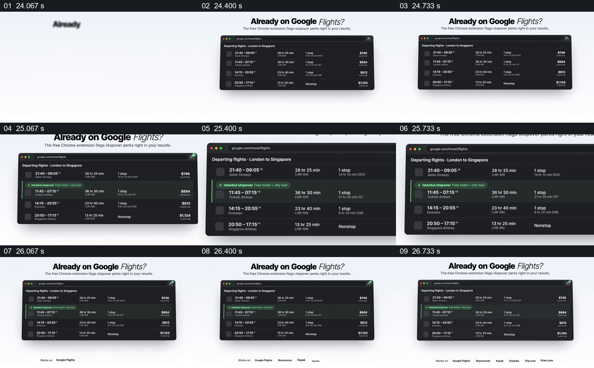

# 在已有搜索结果旁标出新的福利信息

- 作品：案例 021《城市影像与旅行数据》（索引名称）。
- 原片范围：00:24.000–00:27.000，含起点、不含终点；[完整原片](../video.mp4)｜[本卡片段](c03.mp4)。
- 观察方式：依据整片 64 宫格和约每秒一次的真实源帧观察，未连续原速观看或听审；声音、语气与完整播放节奏未确认。

## 原画面具体怎样设计

浅色画面顶部写“Already on Google Flights?”，下方是一张深色航班列表窗口；其中一行以绿色突出，并在航班信息旁加入提示。其余结果仍在列表中可见。

## 为什么这样设计，好在哪里

不要求观众先认识一个全新的页面，而把新提示放回已知的航班列表，让它与原有价格、时间信息一起比较。画面是浏览器功能示意，不能证明实际插件已安装或提示准确。

以上为依据画面的分析，非作者自述；预期观看效果未经观众测试。

## 可直接使用的创意指令

当新信息需要辅助现有决策时，先展示用户熟悉且有授权的原列表，选择真正相关的一行，以清楚但不遮挡原字段的方式加入提示；保留其他条目作为比较参照。需要真实数据时核实来源和更新条件，并区分模拟界面与实际产品功能。
