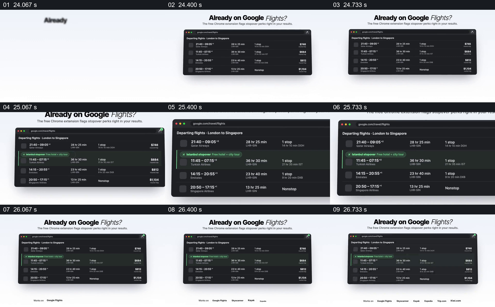

# 在原有航班列表中突出与选择有关的一行

- 作品：案例 021《航线影像与权益比较》（库内索引名称）。
- 原片范围：00:24.000–00:27.000，含起点、不含终点；[完整原片](../video.mp4)｜[本卡片段](c03.mp4)。
- 范围依据：从整页航班结果建立到目标行获得标记并停留，之后进入品牌结尾。
- 观察方式与未确认范围：查看整片 64 帧总览和本卡分镜。未独立完成连续原速观看与听审；抽帧之间的运动、停顿与声音配合待复核。画面中的界面、数字与说明是作品呈现，未经额外核实；设计价值为基于画面的分析。

## 原画面具体怎样设计

浅色背景上方写“Already on Google Flights?”，中央是一张深色航班结果窗口，四条航班按行排列，时间、停留和价格在每行对应列中。整个列表先被看见，没有立即清空其他结果。

随后第二行伊斯坦布尔转机结果上方出现绿色提示条，行左侧同样出现绿色边线；画面局部放大后仍能看到前后航班和该行的价格及中转时长。回到较完整的列表后，底部陆续排列多个网站名称，结束本项功能展示。

## 为什么这样设计，好在哪里

绿色提示依附具体一行，能够把额外权益与该行原来的价格、时长直接联系，而列表中其他行继续保留，比较参照不会丢失。局部扩大让新增信息得到一次阅读机会，随后回到整体，提醒观众它仍发生在熟悉的航班搜索界面内。

这是视频中的界面演示，不能据此确认插件已实际运行或权益真实存在。

## 完整照排指令

以[完整原片](../video.mp4)的 24–27 秒为准。画幅 1280×720，源帧率 30/1。以下拍点为抽帧定位，位置按画幅百分比取近似值。

### 用料

【原航班列表】【目标航班行】【权益标签】取同一次查询；目标行须可按航段和日期在原列表中定位。备【页头短句】【细副句】【品牌图标】【品牌字】【入口按钮】。权益需有可打开的官方条款或结果记录。

### 按源时刻摆放

1. **24.000–约 24.600 秒。** 浅白蓝底，上中一行粗黑【页头短句】及很小【细副句】。中部放近黑圆角【原航班列表】，约占画宽八成，带柔影。行内保留浅色出发、经停、抵达和价格栏，文字按列对齐。
2. **约 24.600–25.800 秒。** 同一表短推近至近满幅，在【目标航班行】内贴窄绿色【权益标签】。标签随同一行缩放，不挤走邻行，不重新排序。之后拉回全表，绿签仍对应原行。可用静态截图分层，过程只发生一次。
3. **约 25.800–27.000 秒。** 航班版退场，近黑背景用小白点连线拼【品牌图标】，下面进入粗白【品牌字】。底部若在边界前露出【入口按钮】，保留初态，按 27.000 秒切出。仅采用列表强调时在暗底出现前结束。

### 局部采用

约 24.000–25.800 秒可作为独立列表强调拍，须同时具备目标行和可核对权益。

### 验证状态

已对照原片每秒两帧画序并读回，核对推入、绿签在行内定位、拉回后原行仍对应及品牌切入。精确切帧、权益小字与换料试摆待核。
