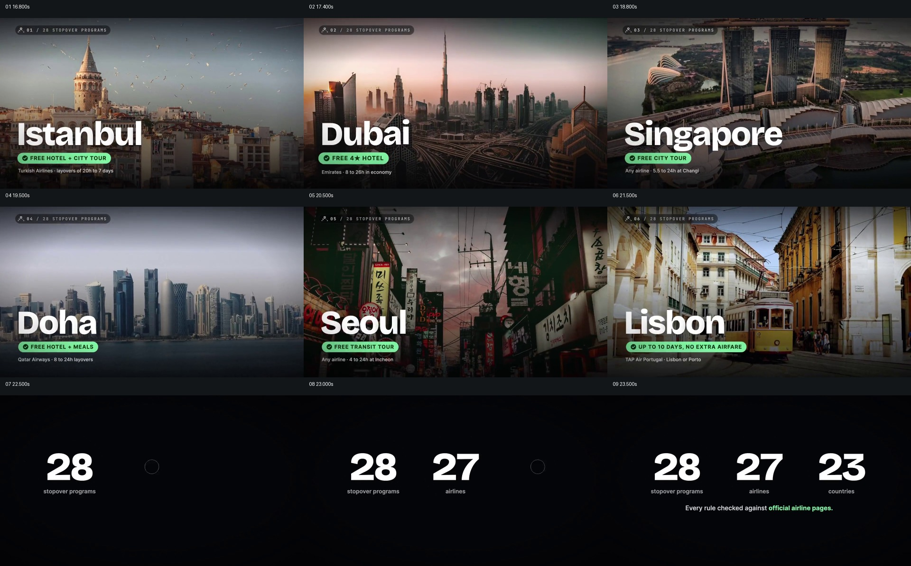

# 从一组城市实景扩展到服务覆盖规模

- 作品：案例 021《航线影像与权益比较》（库内索引名称）。
- 原片范围：00:16.000–00:24.000，含起点、不含终点；[完整原片](../video.mp4)｜[本卡片段](c04-20261111.mp4)。
- 范围依据：从选定方案结束后进入首个城市，依次展示多个城市并以三项覆盖数字收束，之后转入航班网页。
- 观察方式与未确认范围：查看整片 64 帧总览和本卡分镜。未独立完成连续原速观看与听审；抽帧之间的运动、停顿与声音配合待复核。画面中的界面、数字与说明是作品呈现，未经额外核实；设计价值为基于画面的分析。

## 原画面具体怎样设计

画面从伊斯坦布尔城市景观开始，左下大字是城市名，下方绿色短标签写酒店和城市游，顶部小字标出序号。随后迪拜、新加坡、多哈、首尔、里斯本的城市画面依次成为全屏主体，名称与绿色权益条仍落在近似位置，下面还有更小的航司或停留条件。

每一次城市变化都保留相近的信息层级：先辨认场景和大字，再看绿色权益和小字条件；左上序号让不同地点属于同一组。接近 22 秒时实景退出，黑底依次显出 28 个项目、27 家航司、23 个国家，下面写规则核对来源的说明，构成由具体例子到总体范围的结果。

## 为什么这样设计，好在哪里

场景照片各不相同，而名称、权益标签与序号位置稳定，因此观众可以识别每次换地点时哪些信息是同类项。最后从六个具体地点切到三项数字，将零散例子归为一个覆盖范围；没有前面的地点画面，统计难以对应具体体验；没有最后数字，则看不出这组例子与整体规模的关系。

画中福利、数字和核验声明仅作为原片内容，未独立证明。

## 完整照排指令

以[完整原片](../video.mp4)的 16–24 秒为准。画幅 1280×720，源帧率 30/1。以下拍点为抽帧定位，位置按画幅百分比取近似值。

### 用料

【城市实景组】【城市名称组】【城市权益组】各备六项，按同一服务覆盖清单成组配对。实景宜有独特地标、城区轮廓或街景，文字所在的左下区域允许压暗。另备【规模终值组】【规模单位组】【统计附注】【邻段问句】【邻段结果表】。地名、权益和汇总指标须能回查到可打开的官方条款或数据，注明时间及范围，不把中途滚动值当统计。

### 按源时刻摆放

1. **16.000–约 22.000 秒。** 依次满幅切入【城市实景组】，原片顺序为伊斯坦布尔、迪拜、新加坡、多哈、首尔、里斯本。约每秒交给下一地点，城市大标题固定左下、距左约 6%、距底约 20%，白色粗无衬线。【城市名称组】先建字形，再在正下方用细嫩绿胶囊显示短【城市权益组】。局部暗渐层托住字，不盖地标；顶部可留极细的暗提示。到下一城时地点名和权益一同换，禁用上一城市标签跨新城镜头。景别允许交替远景与街道；当车辆或行人承担可见动作时从入场连续播放到切出，景观静照可轻推。
2. **约 22.000–23.600 秒。** 城市版全部退出。近黑底中部横向排三组指标，第一组先用粗白整数出现，第二、三组随后从各自原位滚到【规模终值组】。原片约 23 秒附近已见首两值，第三值最后收稳。这三组各有小白【规模单位组】，基线一致。底下另留低亮居中【统计附注】，可用一处青绿强调。三组都成立时仍同屏，禁止保留城市权益胶囊盖到指标上。
3. **约 23.600–24.000 秒。** 按索引边界切出。若完整原片在边界前已出现浅底，保留上部黑色【邻段问句】和中部近黑【邻段结果表】首态；若这两层实际在边界后，留给邻卡，不提前移入。

### 局部采用

有单一城市的真实实景和权益可独立采用该城市约一秒的卡面，并按字量延长。只有汇总统计可采用约 22.000–23.600 秒的三数字版。缺少中间城市时，可保留已获授权的顺序，并按剩余案例重新表述范围。

### 验证状态

已对照原片每秒两帧画序并读回，核对城市名与绿签的固定位置、六景独立换入、最后三项指标在黑底累积。城市换镜及浅页起点的精确帧、权益小字和换料试摆待核。
