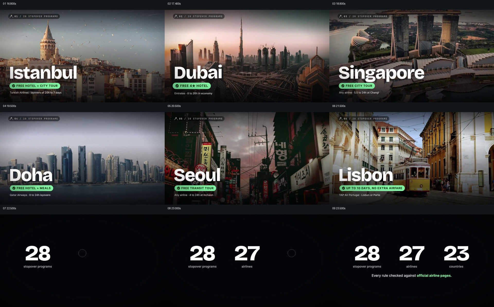

# 从一组城市实景扩展到服务覆盖规模

- 作品：案例 021《航线影像与权益比较》（库内索引名称）。
- 原片范围：00:16.000–00:24.000，含起点、不含终点；[完整原片](../video.mp4)｜[本卡片段](c04-20261111.mp4)。
- 范围依据：从选定方案结束后进入首个城市，依次展示多个城市并以三项覆盖数字收束，之后转入航班网页。
- 观察方式与未确认范围：查看整片 64 帧总览和本卡分镜。未独立完成连续原速观看与听审；抽帧之间的运动、停顿与声音配合待复核。画面中的界面、数字与说明是作品呈现，未经额外核实；设计价值为基于画面的分析。

## 原画面具体怎样设计

画面从伊斯坦布尔城市景观开始，左下大字是城市名，下方绿色短标签写酒店和城市游，顶部小字标出序号。随后迪拜、新加坡、多哈、首尔、里斯本的城市画面依次成为全屏主体，名称与绿色权益条仍落在近似位置，下面还有更小的航司或停留条件。

每一次城市变化都保留相近的信息层级：先辨认场景和大字，再看绿色权益和小字条件；左上序号让不同地点属于同一组。接近 22 秒时实景退出，黑底依次显出 28 个项目、27 家航司、23 个国家，下面写规则核对来源的说明，构成由具体例子到总体范围的结果。

## 为什么这样设计，好在哪里

场景照片各不相同，而名称、权益标签与序号位置稳定，因此观众可以识别每次换地点时哪些信息是同类项。最后从六个具体地点切到三项数字，将零散例子归为一个覆盖范围；没有前面的地点画面，统计难以对应具体体验；没有最后数字，则看不出这组例子与整体规模的关系。

画中福利、数字和核验声明仅作为原片内容，未独立证明。

## 可直接使用的创意指令

要展示跨地区的多个案例时，为每个地点准备能够辨认的实际场景和同口径的核心信息；让地点名、主要区别和必要条件在各画面中保持稳定阅读层级，同时允许素材本身不同。实例展示完毕后，再以有来源的总量和统计对象收束，使具体体验与整体范围对应。

地点数量、文字位置与颜色可调整，但不要让美景替代条件，也不要将示例数当成实际总量。

本方法尚未在新题材中实测。
