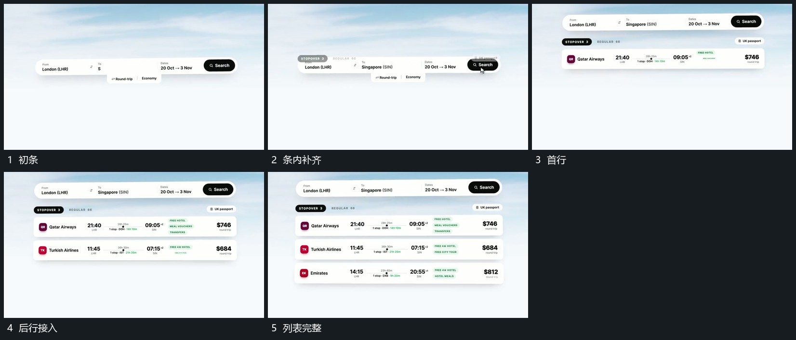

# 固定长条填字，下方短卡逐行补入

## 运动指令

保持上方长条，先补齐内部短字，再从其下方逐行接入横向短卡。前一行到位后继续留场，后一行补入，末尾形成完整列表。

## 视频切片

[播放本机制的原片切片](m01.mp4)

覆盖分镜中“初条”至“列表完整”的连续过程，并保留邻近的前后衔接画面；原片中交叠发生的动作一并保留。

## 分镜过程

## 组合与调整

可改行数，保留上条与下行层级，不把列表全部一次闪出。
